# Barframe apps

Free and open source. If an app saves you time, you can support the work on [GitHub Sponsors](https://github.com/sponsors/theluckystrike), [PayPal](https://paypal.me/najzzz) or [Buy Me a Coffee](https://buymeacoffee.com/michaellip).

This repository holds the source code for 29 small Mac apps by Michael Lip. Most of them run in the menu bar. NativeLedger is a regular window app. Each app is a Swift package built with SwiftUI and AppKit. Most apps share one small helper package, `kit/MASKit`.

All code is under the MIT License. See [LICENSE](LICENSE).

## Apps

| App | What it does | Get it | Screenshot |
|---|---|---|---|
| [CacheSlope](apps/CacheSlope/) | Find folders that keep growing | [Download](https://github.com/theluckystrike/barframe-apps/releases/download/cacheslope-v1.0.0/CacheSlope-1.0.0.dmg) | <a href="apps/CacheSlope/">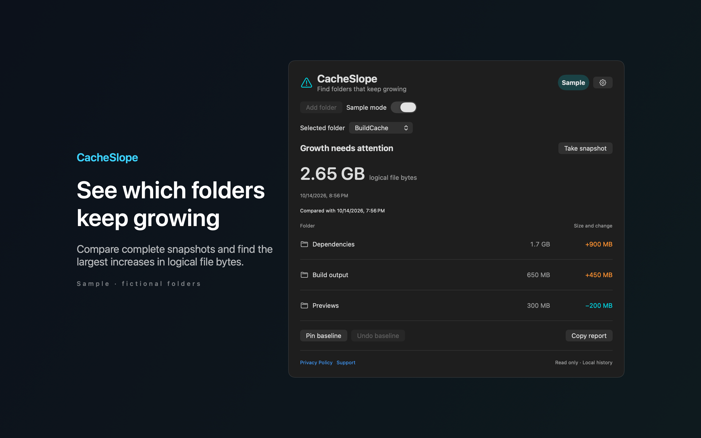</a> |
| [CallReady](apps/CallReady/) | Next call, mic guard and mute key | [Download](https://github.com/theluckystrike/barframe-apps/releases/download/callready-v1.0.1/CallReady-1.0.1.dmg) | <a href="apps/CallReady/">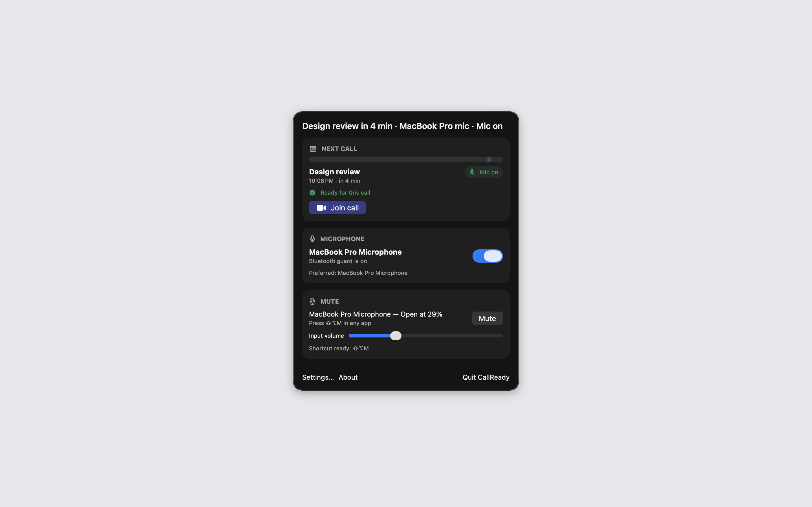</a> |
| [CaptionCove](apps/CaptionCove/) | Check subtitle delivery parity | [Download](https://github.com/theluckystrike/barframe-apps/releases/download/captioncove-v1.0.0/CaptionCove-1.0.0.dmg) | <a href="apps/CaptionCove/">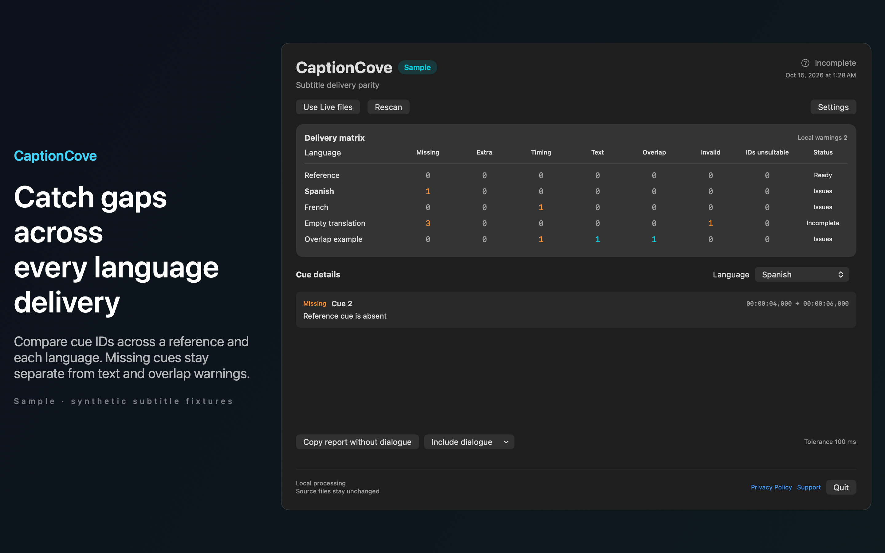</a> |
| [CheckHarbor](apps/CheckHarbor/) | Track builds until recovery | [Download](https://github.com/theluckystrike/barframe-apps/releases/download/checkharbor-v1.0.0/CheckHarbor-1.0.0.dmg) | <a href="apps/CheckHarbor/">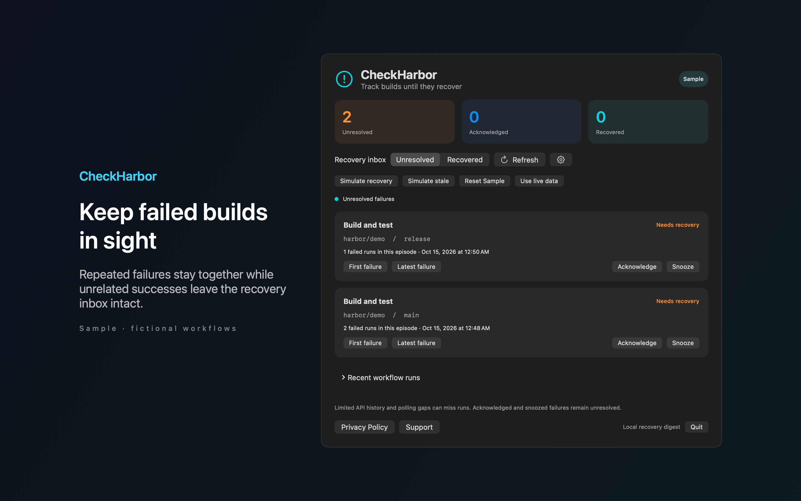</a> |
| [ColumnLatch](apps/ColumnLatch/) | Check recurring CSV imports | [Download](https://github.com/theluckystrike/barframe-apps/releases/download/columnlatch-v1.0.0/ColumnLatch-1.0.0.dmg) | <a href="apps/ColumnLatch/">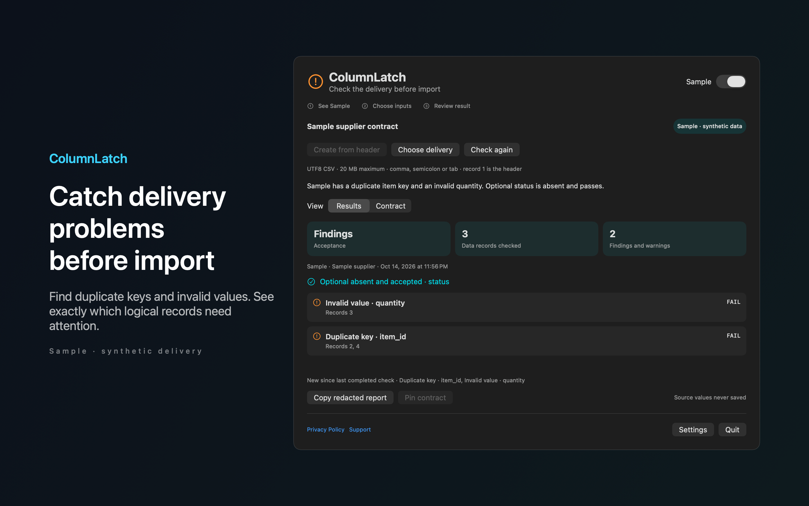</a> |
| [CostBar](apps/CostBar/) | AI API cost & budget monitor | [Download](https://github.com/theluckystrike/barframe-apps/releases/download/costbar-v1.0.0/CostBar-1.0.0.dmg) | <a href="apps/CostBar/">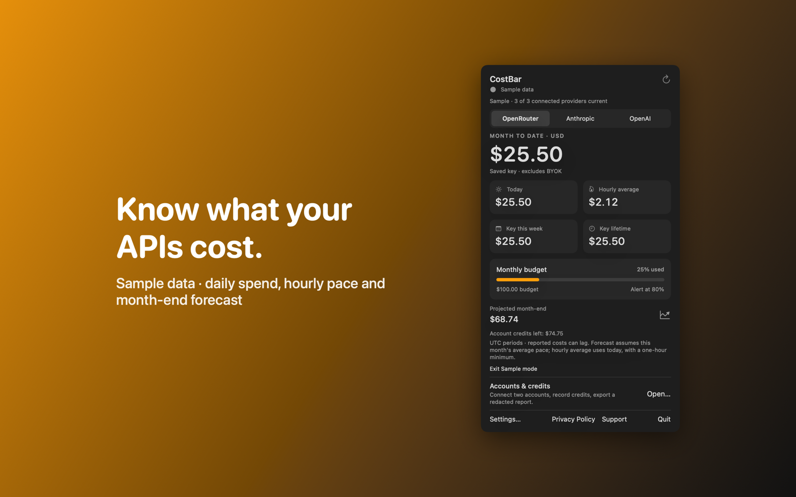</a> |
| [CronSpindle](apps/CronSpindle/) | Find schedule collisions | [Download](https://github.com/theluckystrike/barframe-apps/releases/download/cronspindle-v1.0.0/CronSpindle-1.0.0.dmg) | <a href="apps/CronSpindle/">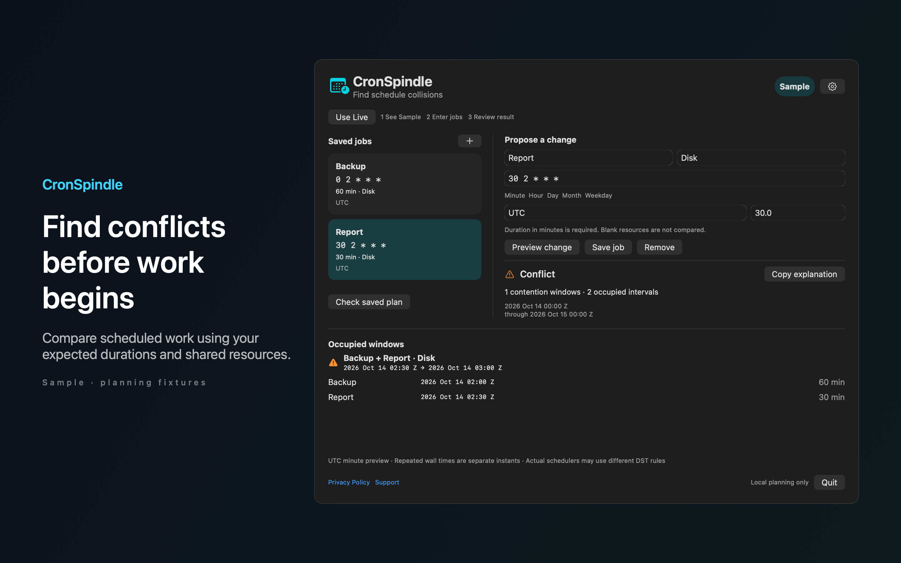</a> |
| [EnvTrellis](apps/EnvTrellis/) | Check environment readiness | [Download](https://github.com/theluckystrike/barframe-apps/releases/download/envtrellis-v1.0.0/EnvTrellis-1.0.0.dmg) | <a href="apps/EnvTrellis/">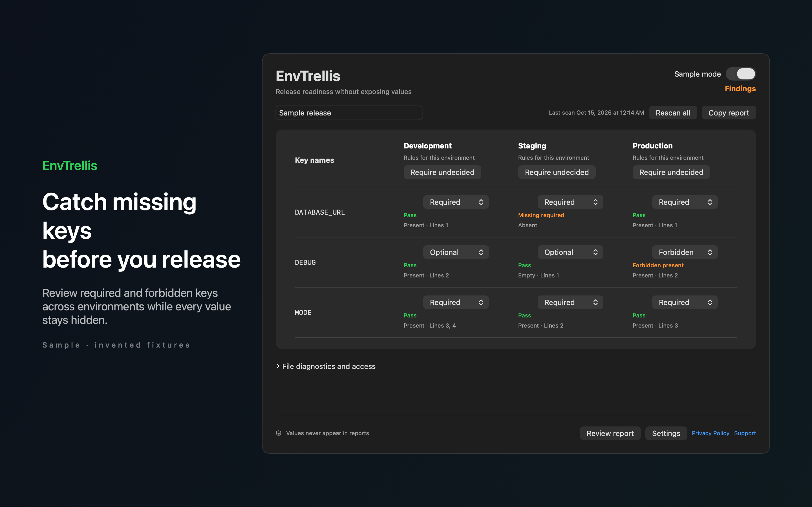</a> |
| [HashDock](apps/HashDock/) | Verify every delivery copy | [Download](https://github.com/theluckystrike/barframe-apps/releases/download/hashdock-v1.0.0/HashDock-1.0.0.dmg) | <a href="apps/HashDock/">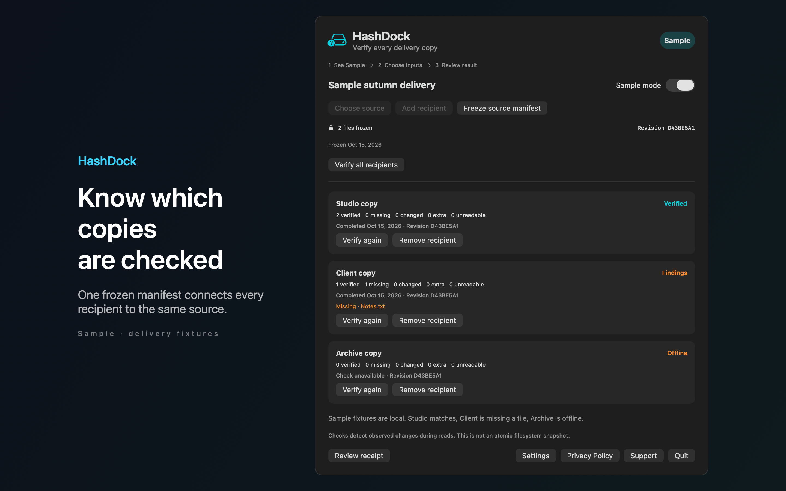</a> |
| [Headroom Agent Memory](apps/Headroom/) | Memory pressure & swap budget | [Download](https://github.com/theluckystrike/barframe-apps/releases/download/headroom-v1.0.0/Headroom-1.0.0.dmg) | <a href="apps/Headroom/">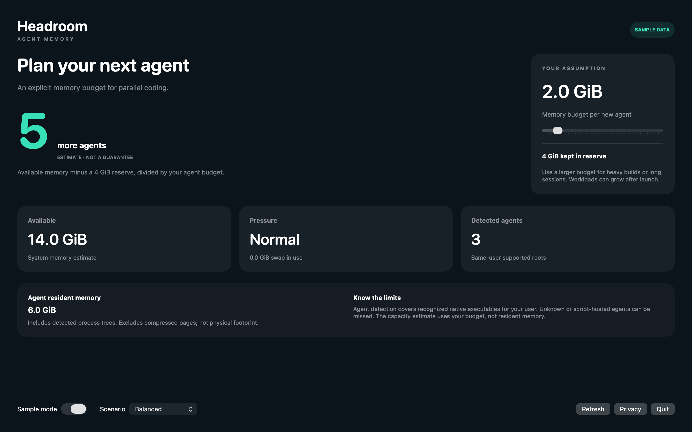</a> |
| [HushKey Mic Mute Hotkey](apps/HushKey/) | Hold to talk, release to mute | [Download](https://github.com/theluckystrike/barframe-apps/releases/download/hushkey-v1.0.0/HushKey-1.0.0.dmg) | <a href="apps/HushKey/">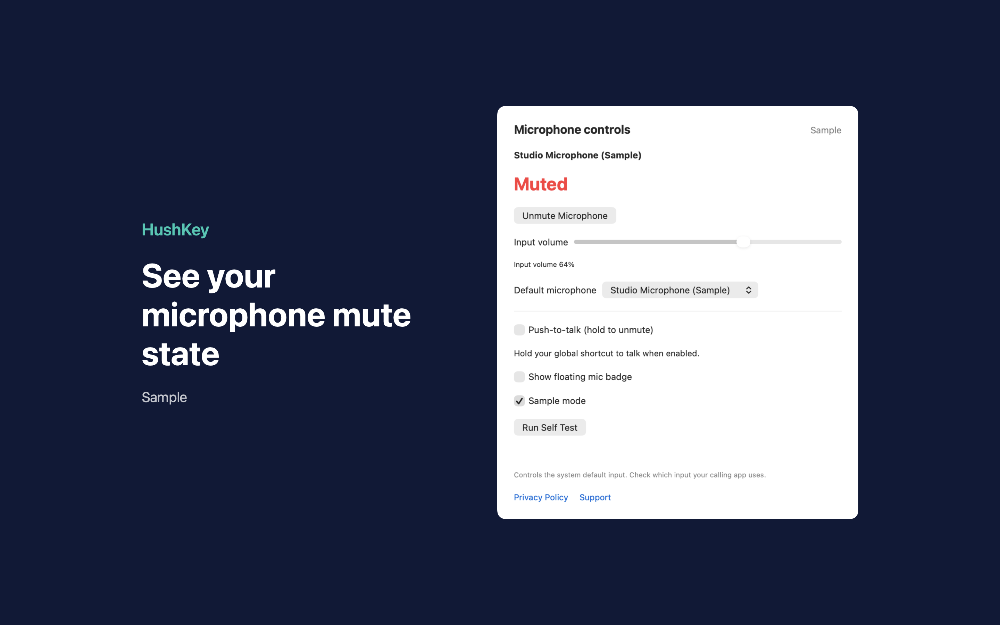</a> |
| [KeyOverlap](apps/KeyOverlap/) | Check shortcut plan conflicts | [Download](https://github.com/theluckystrike/barframe-apps/releases/download/keyoverlap-v1.0.0/KeyOverlap-1.0.0.dmg) | <a href="apps/KeyOverlap/">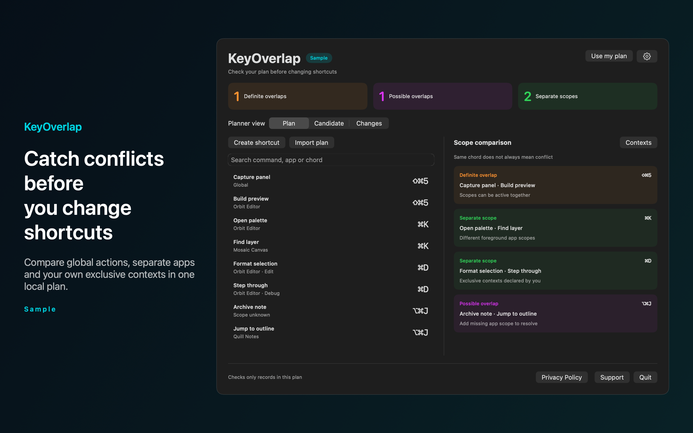</a> |
| [LinkSprig](apps/LinkSprig/) | Preview broken document links | [Download](https://github.com/theluckystrike/barframe-apps/releases/download/linksprig-v1.0.0/LinkSprig-1.0.0.dmg) | <a href="apps/LinkSprig/">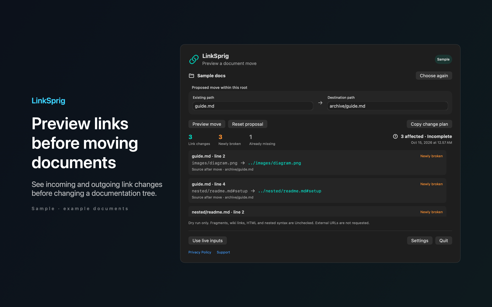</a> |
| [MarkShot Screenshot Markup](apps/MarkShot/) | Arrows, annotations and steps | [Download](https://github.com/theluckystrike/barframe-apps/releases/download/markshot-v1.0.0/MarkShot-1.0.0.dmg) | <a href="apps/MarkShot/">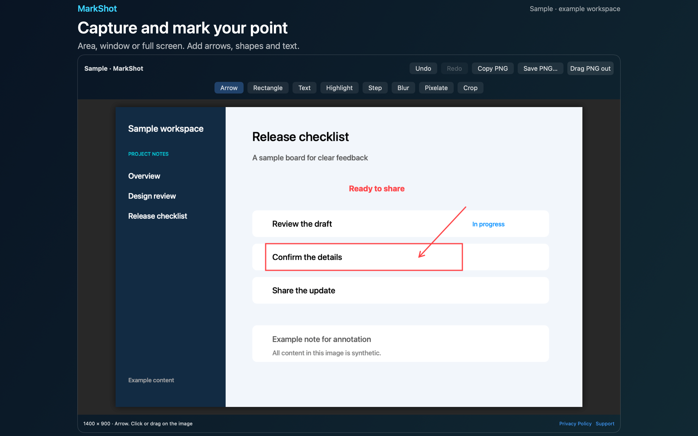</a> |
| [MeetNext](apps/MeetNext/) | Meeting countdown & timeline | [Download](https://github.com/theluckystrike/barframe-apps/releases/download/meetnext-v1.0.0/MeetNext-1.0.0.dmg) | <a href="apps/MeetNext/">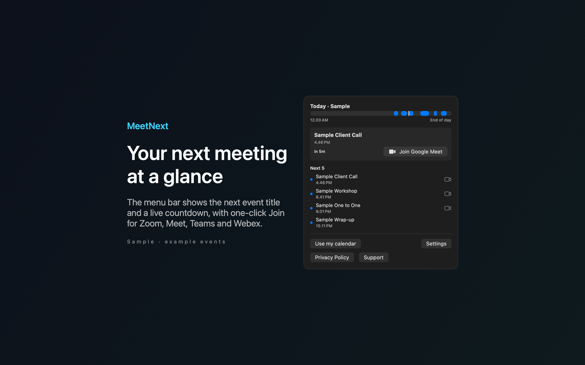</a> |
| [MicAnchor](apps/MicAnchor/) | Default mic priority keeper | [Download](https://github.com/theluckystrike/barframe-apps/releases/download/micanchor-v1.0.0/MicAnchor-1.0.0.dmg) | <a href="apps/MicAnchor/">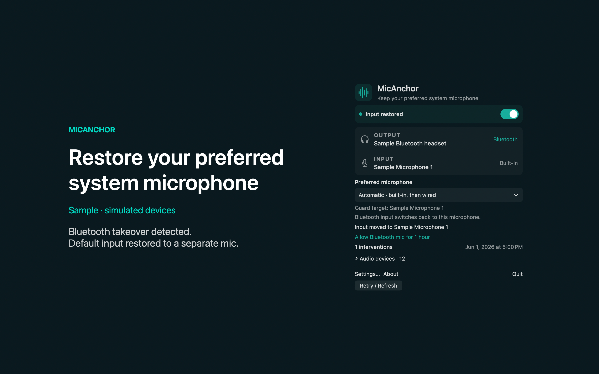</a> |
| [NameWeave](apps/NameWeave/) | Check filename portability | [Download](https://github.com/theluckystrike/barframe-apps/releases/download/nameweave-v1.0.0/NameWeave-1.0.0.dmg) | <a href="apps/NameWeave/">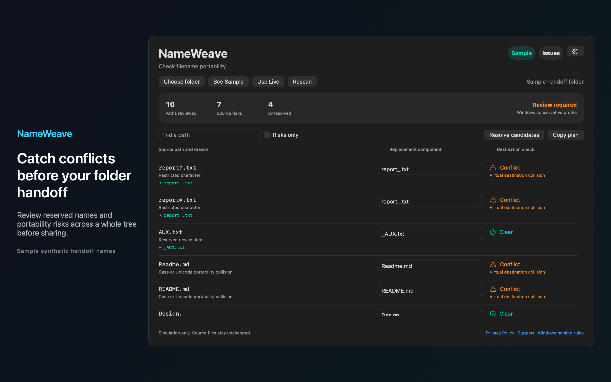</a> |
| [NativeLedger](apps/NativeLedger/) | Automatic app update ledger | [Download](https://github.com/theluckystrike/barframe-apps/releases/download/nativeledger-v1.0.0/NativeLedger-1.0.0.dmg) | <a href="apps/NativeLedger/">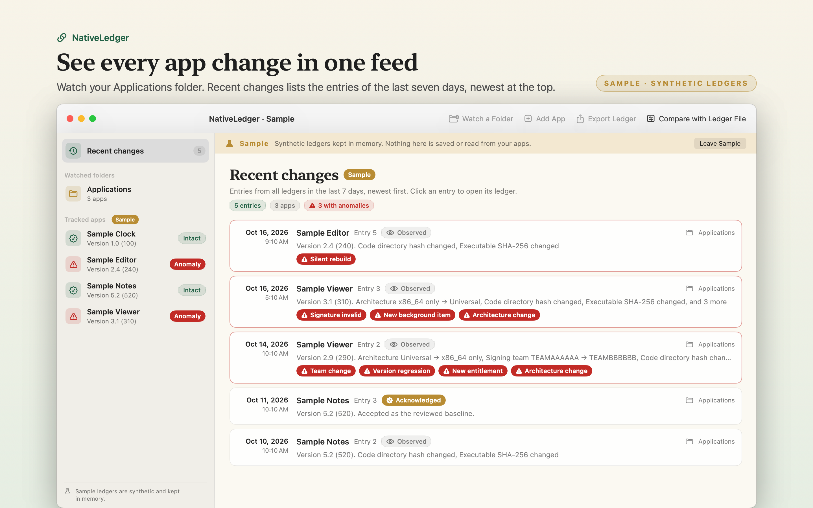</a> |
| [PageParcel](apps/PageParcel/) | Plan duplex document packets | [Download](https://github.com/theluckystrike/barframe-apps/releases/download/pageparcel-v1.0.0/PageParcel-1.0.0.dmg) | <a href="apps/PageParcel/">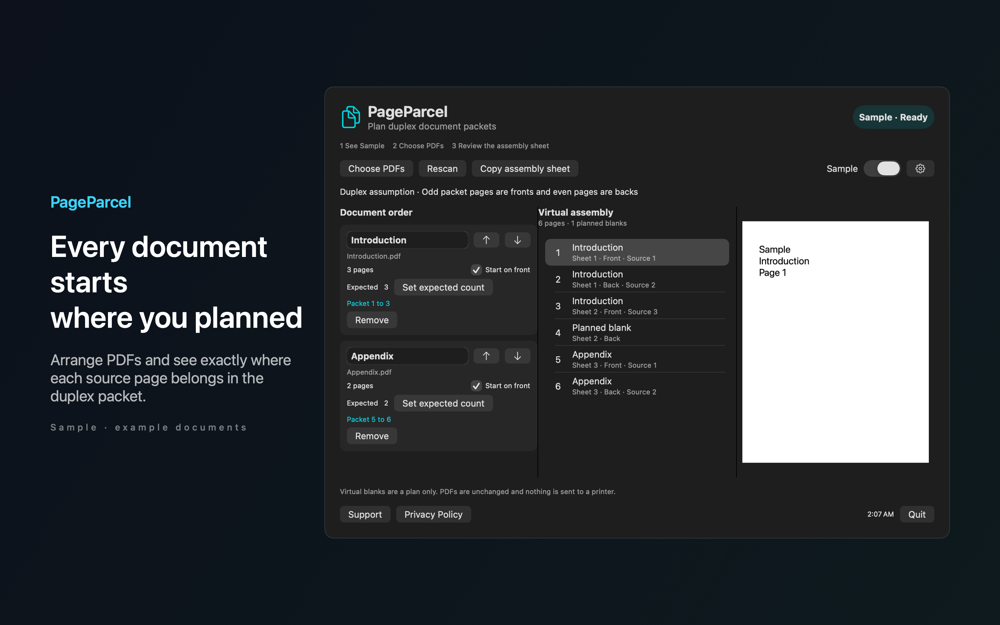</a> |
| [PermitPeek](apps/PermitPeek/) | See app permission changes | [Download](https://github.com/theluckystrike/barframe-apps/releases/download/permitpeek-v1.0.0/PermitPeek-1.0.0.dmg) | <a href="apps/PermitPeek/">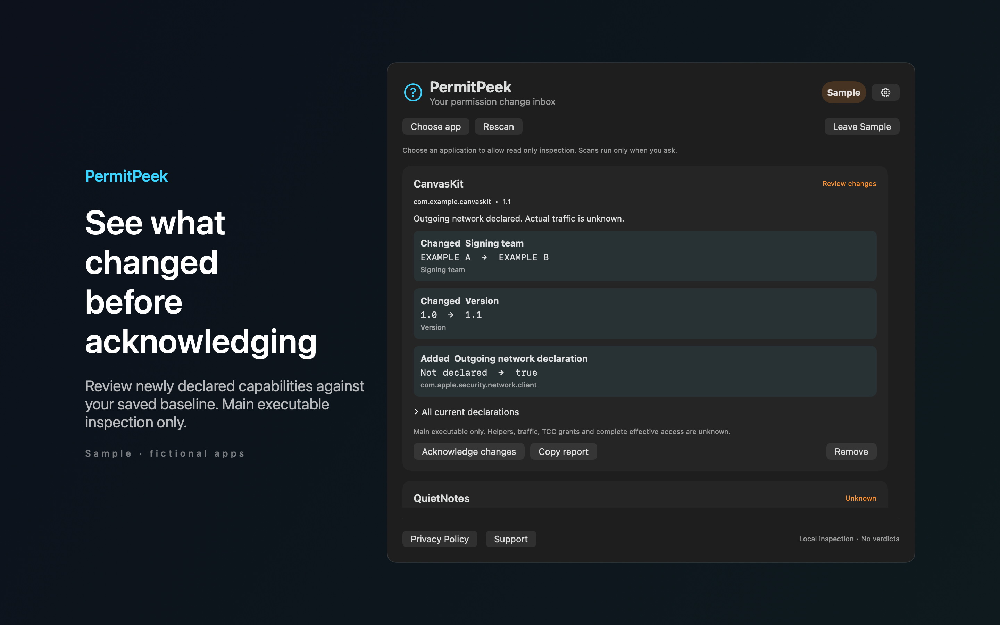</a> |
| [PortSense](apps/PortSense/) | Charger wattage & USB devices | [Download](https://github.com/theluckystrike/barframe-apps/releases/download/portsense-v1.0.0/PortSense-1.0.0.dmg) | <a href="apps/PortSense/">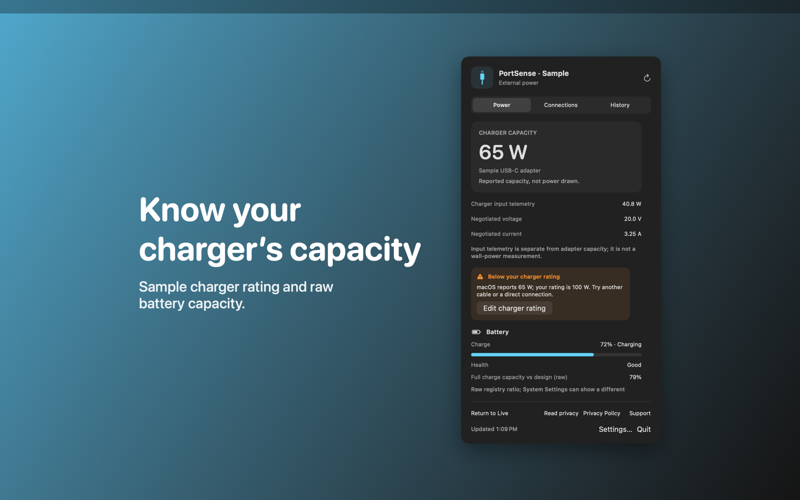</a> |
| [QuotaPace](apps/QuotaPace/) | Token pace & usage limits | [Download](https://github.com/theluckystrike/barframe-apps/releases/download/quotapace-v1.0.0/QuotaPace-1.0.0.dmg) | <a href="apps/QuotaPace/">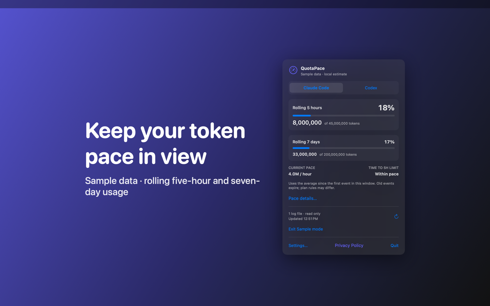</a> |
| [RelayNook](apps/RelayNook/) | Coding agent alerts & hooks | [Download](https://github.com/theluckystrike/barframe-apps/releases/download/relaynook-v1.0.0/RelayNook-1.0.0.dmg) | <a href="apps/RelayNook/">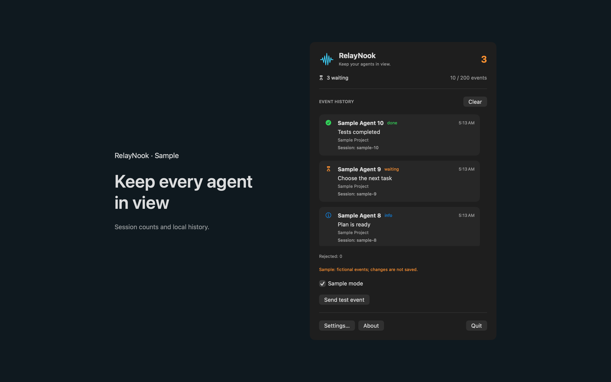</a> |
| [ReminderVault](apps/ReminderVault/) | Markdown tasks and reminders | [Download](https://github.com/theluckystrike/barframe-apps/releases/download/remindervault-v1.0.0/ReminderVault-1.0.0.dmg) | <a href="apps/ReminderVault/">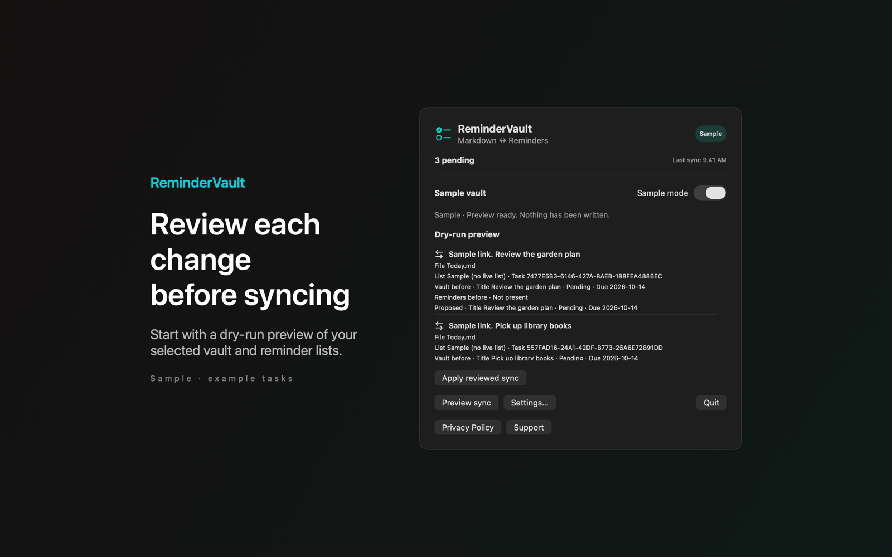</a> |
| [RevPulse Revenue at a Glance](apps/RevPulse/) | Net payments in your menu bar | [Download](https://github.com/theluckystrike/barframe-apps/releases/download/revpulse-v1.0.0/RevPulse-1.0.0.dmg) | <a href="apps/RevPulse/">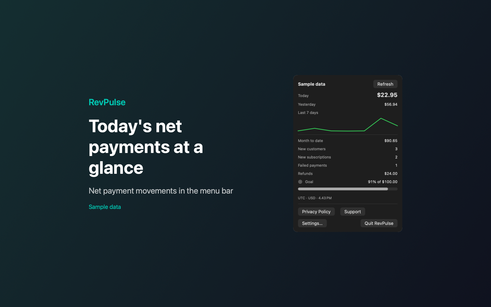</a> |
| [RouteLoom Connection Report](apps/RouteLoom/) | Compare connection failures | [Download](https://github.com/theluckystrike/barframe-apps/releases/download/routeloom-v1.0.0/RouteLoom-1.0.0.dmg) | <a href="apps/RouteLoom/">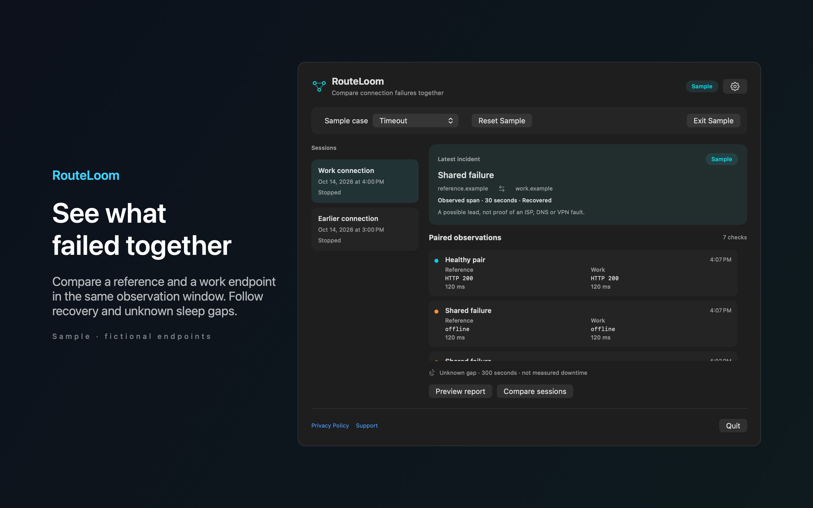</a> |
| [ShelfDock](apps/ShelfDrop/) | Drag & drop file staging | [Download](https://github.com/theluckystrike/barframe-apps/releases/download/shelfdrop-v1.0.0/ShelfDock-1.0.0.dmg) | <a href="apps/ShelfDrop/">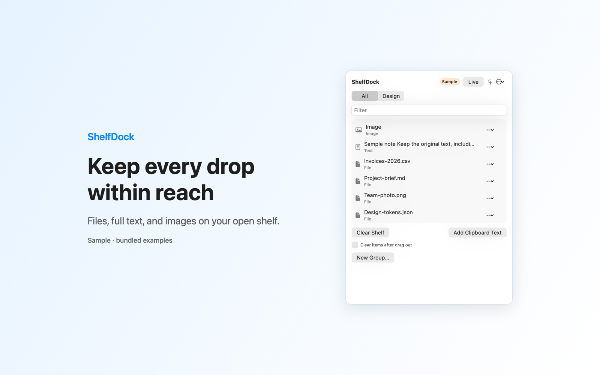</a> |
| [Starglass Night Sky Planner](apps/Starglass/) | Cloud and moon night planner | [Download](https://github.com/theluckystrike/barframe-apps/releases/download/starglass-v1.0.0/Starglass-1.0.0.dmg) | <a href="apps/Starglass/">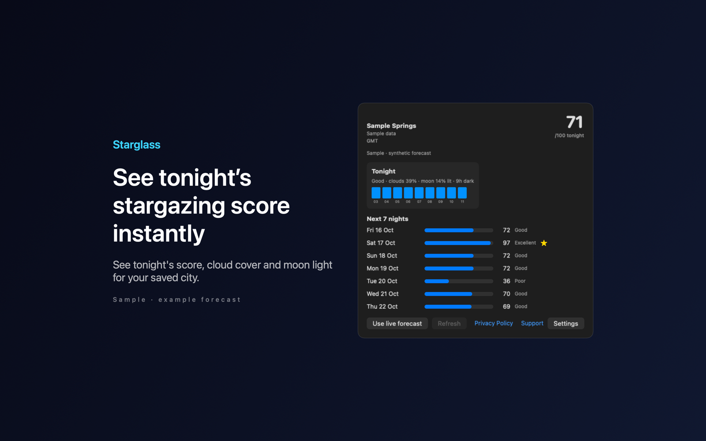</a> |
| [StepQuay](apps/StepQuay/) | Resume your next small task | [Download](https://github.com/theluckystrike/barframe-apps/releases/download/stepquay-v1.0.0/StepQuay-1.0.0.dmg) | <a href="apps/StepQuay/">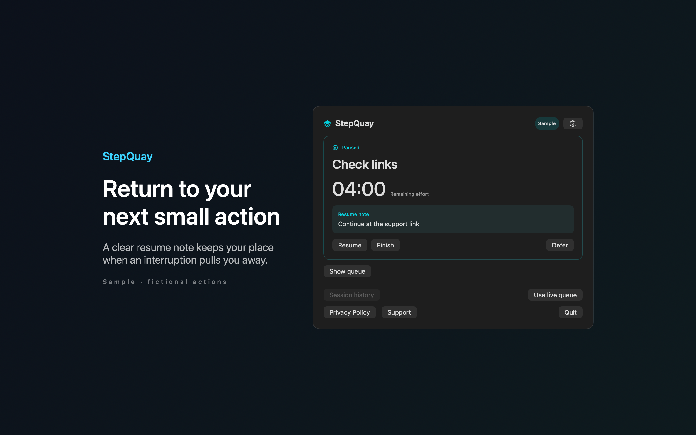</a> |

Each app folder has a README with features, requirements, build steps and privacy notes.

## Install with Homebrew

Each app has a cask in the [barframe tap](https://github.com/theluckystrike/homebrew-barframe). Use the app name in lower case. Homebrew 7 asks you to trust the tap one time before the first install.

```sh
brew trust --tap theluckystrike/barframe
brew install --cask theluckystrike/barframe/cacheslope
```

ShelfDock is `shelfdock`. The source folder of ShelfDock is `apps/ShelfDrop`.

## Build an app

You need Xcode 16 or later (Swift 5.9 or later) on macOS 14 or later.

```sh
cd apps/CostBar
swift build -c release
swift test
```

Most packages refer to `../../kit/MASKit`. Keep the folder layout when you copy an app.

Some scripts in `apps/*/scripts` are release helpers for the author's own signing setup. You do not need them to build or run an app.

## Status

All 29 apps are free under the MIT License. 29 of them have a signed download that Apple has notarized, so they open without warnings. Each download is on the [Releases](https://github.com/theluckystrike/barframe-apps/releases) page with its SHA-256.

These apps were made for the Mac App Store. Apple rejected them under guideline 4.3 after too many submissions from a new account, so they are published here instead. The full story is at https://barframe.com/open-source/.

## Related

- Website: https://barframe.com/open-source/

## Support this work

These apps are free and open source. If one saves you time, you can support more of them:

- [GitHub Sponsors](https://github.com/sponsors/theluckystrike)
- [PayPal](https://paypal.me/najzzz)
- [Buy Me a Coffee](https://buymeacoffee.com/michaellip)

A star on this repository also helps other people find it.

## More from the author

- [Zovo](https://zovo.one/). Chrome extensions and free online tools.
- [BeLikeNative](https://www.belikenative.com/). Check your English in a Chrome side panel.
- [NoteMods](https://notemods.com/). Open source Obsidian plugins for Bases, tables and tasks.
- [ml0x](https://ml0x.com/). Guardrails, tests and budget caps for Claude Code agents.
- [Axdale](https://axdale.com/). Hire an agentic full-stack developer in Warsaw.

All projects by Michael Lip are listed at https://barframe.com/projects/.

## Contact

Open an issue in this repository. Email: support@barframe.com.
