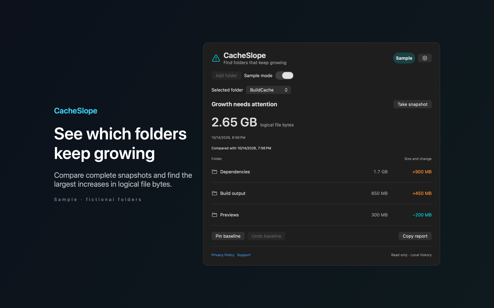
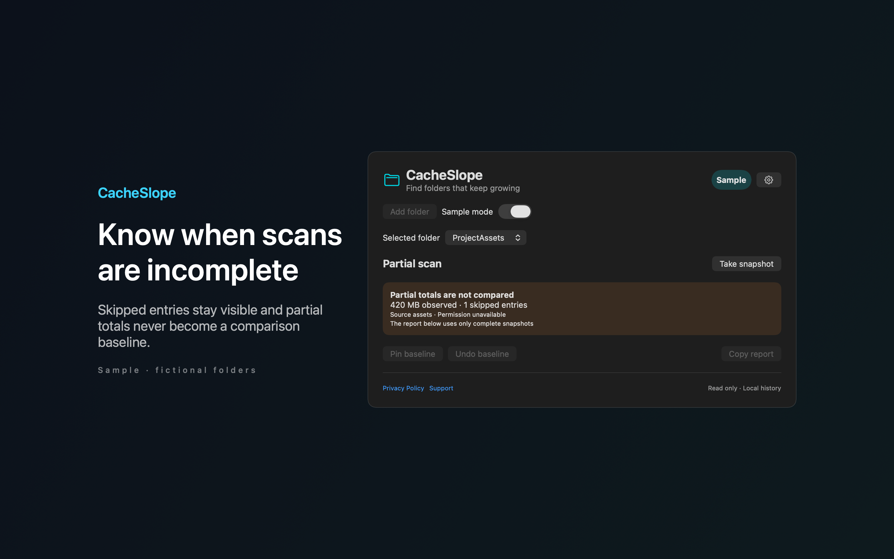

# CacheSlope

CacheSlope is a Mac menu bar app that shows which folders grew since your last complete scan.





## Features

- Compares a new folder scan with the previous complete scan and lists the largest increases first.
- Marks a scan as partial when it skips symbolic links, cloud files that are not downloaded or unreadable items. Partial scans are not compared.
- Pins a baseline snapshot, and you can undo a baseline replacement. Sets a growth threshold for each folder.
- Copies a change report, or reveals a folder in Finder.
- Includes sample data, so you can try the app without a real folder.

## Download

Download [CacheSlope-1.0.0.dmg](https://github.com/theluckystrike/barframe-apps/releases/download/cacheslope-v1.0.0/CacheSlope-1.0.0.dmg) for macOS 14 or later. It is signed with Developer ID and notarized by Apple. The [release page](https://github.com/theluckystrike/barframe-apps/releases/tag/cacheslope-v1.0.0) lists its SHA-256.

## Requirements

- macOS 14.0 or later.
- Sandboxed. Read-only access to folders that you choose in the system folder picker.

## Build

You need Xcode 16 or later (Swift 5.9 or later).

```sh
cd apps/CacheSlope
swift build -c release
```

The package depends on `../../kit/MASKit` by path. Clone the whole repository, so that the folder layout stays the same.

## Privacy

Folder names, bookmarks and snapshots stay on your Mac. The app has no accounts, no analytics and makes no network requests. Full policy: [store/privacy.md](store/privacy.md).

## Support this work

This app is free and open source. If it saves you time, you can support more apps like it through [GitHub Sponsors](https://github.com/sponsors/theluckystrike), [PayPal](https://paypal.me/najzzz) or [Buy Me a Coffee](https://buymeacoffee.com/michaellip).

More free apps and tools by the author are at https://barframe.com/projects/.

## License

MIT. See [LICENSE](../../LICENSE).
