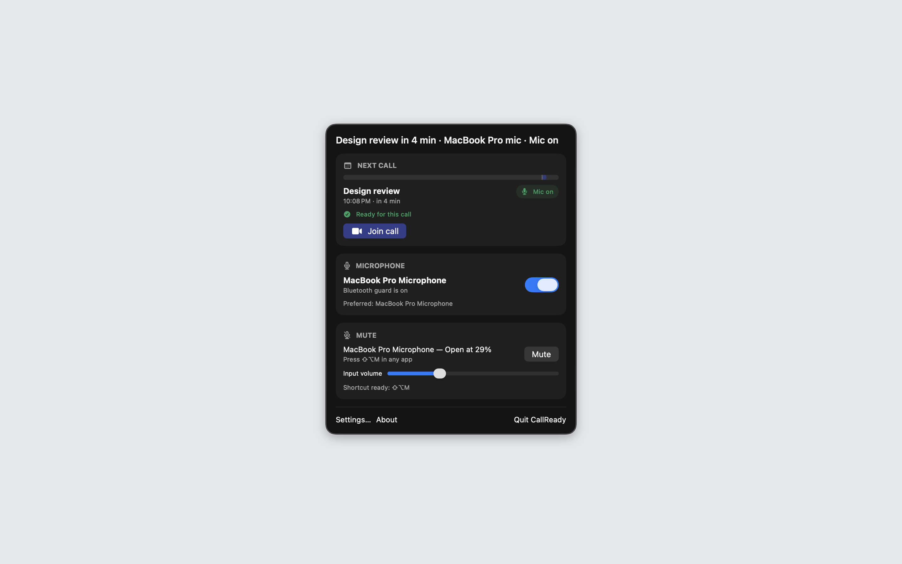
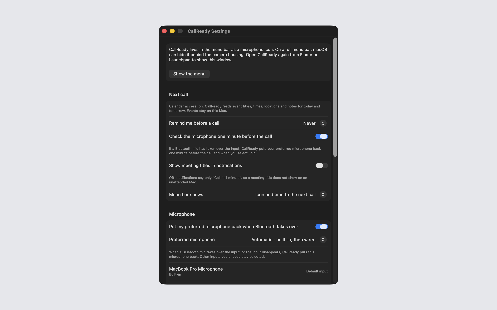

# CallReady

CallReady is a Mac menu bar app that shows your next call, puts your preferred microphone back when a Bluetooth headset takes over, and mutes the microphone with one shortcut.





## Features

- Shows the next event from the calendars you select, with a countdown in the menu bar. Join opens the Zoom, Google Meet, Microsoft Teams or Webex link that it finds in the event URL, location or notes.
- When the default input is a Bluetooth microphone, or the default input is no longer available, sets the default input to your preferred microphone or the next backup in your list. It skips virtual and loopback devices. You can allow a Bluetooth microphone for 1 hour from the menu.
- Mutes and unmutes the default microphone with a global shortcut in any app. The default is Shift-Option-M. Push-to-talk and a floating mute badge are optional. For a microphone without a mute control, it sets the input volume to zero.
- Checks the microphone one minute before a call and again when you click Join. It can remind you one minute before a call if you are still muted.
- Optional call reminders 5, 10 or 15 minutes before a call, as local notifications.

## Download

Download [CallReady-1.0.1.dmg](https://github.com/theluckystrike/barframe-apps/releases/download/callready-v1.0.1/CallReady-1.0.1.dmg) for macOS 14 or later. It is signed with Developer ID and notarized by Apple. The [release page](https://github.com/theluckystrike/barframe-apps/releases/tag/callready-v1.0.1) lists its SHA-256.

## Requirements

- macOS 14.0 or later.
- Sandboxed. Calendar access to read events for the next call. CallReady never creates, changes or deletes events. The microphone and mute parts work without calendar access.
- No microphone permission. CallReady does not open an audio stream. It changes only the default input, its mute state and its input volume.
- Notification permission only if you turn on a call reminder or the mute reminder.
- Your calling app must use the system default input, for example "Same as System" in its audio settings.

## Build

You need Xcode 16 or later (Swift 5.9 or later).

```sh
cd apps/CallReady
swift build -c release
```

## Privacy

Calendar events and settings stay on your Mac. CallReady collects no data, has no analytics and makes no network connections of its own. It never records or listens to audio. Full policy: [barframe.com/apps/callready/privacy](https://barframe.com/apps/callready/privacy/).

## Support this work

This app is free and open source. If it saves you time, you can support more apps like it through [GitHub Sponsors](https://github.com/sponsors/theluckystrike), [PayPal](https://paypal.me/najzzz) or [Buy Me a Coffee](https://buymeacoffee.com/michaellip).

More free apps and tools by the author are at https://barframe.com/projects/.

## License

MIT. See [LICENSE](../../LICENSE).
