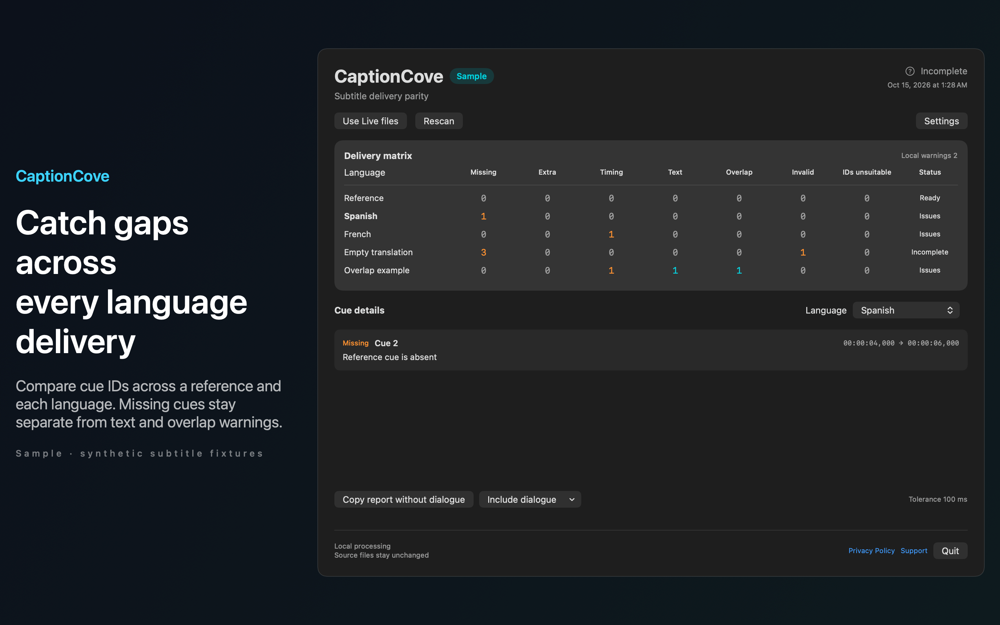

# CaptionCove

Catch missing or shifted subtitle cues across language deliveries before handing over your final files.



## Features

- Choose a reference SRT and add translated SRT files with a language label. CaptionCove compares unique cue IDs and shows missing cues, extra cues and signed timing drift in a delivery matrix. Open each language to review cue timings and a short local text preview.
- Set your own timing tolerance and visible text speed rule. Text warnings and temporal overlaps stay separate from reference parity failures. Invalid timing, duplicate IDs, empty translations and unsuitable cue identity prevent a complete parity claim. Mixed missing and extra IDs or recognizable shifted ID runs are marked unsuitable. Arbitrary renumbering cannot always be detected from SRT alone. CaptionCove does not edit subtitles or align cues by position.
- Save a pinned project with file bookmarks and rules. Rescan when ready and review the latest state in the menu bar. Resolved stale bookmarks are renewed. If file access is unavailable, choose the file again. Other readable languages remain in the matrix. Reports omit dialogue text by default and can be copied locally with an explicit option to include text.
- See Sample to explore synthetic deliveries without selecting files. English and Spanish interface options are included. Customize the panel shortcut and appearance in Settings.
- Your files and settings stay on your Mac. No accounts, ads, analytics or automatic network calls. Clear stored references and summaries without deleting source files.

## Download

Download [CaptionCove-1.0.0.dmg](https://github.com/theluckystrike/barframe-apps/releases/download/captioncove-v1.0.0/CaptionCove-1.0.0.dmg) for macOS 14 or later. It is signed with Developer ID and notarized by Apple. The [release page](https://github.com/theluckystrike/barframe-apps/releases/tag/captioncove-v1.0.0) lists its SHA-256.

## Requirements

- macOS 14.0 or later.
- Sandboxed.
- Reads only the files and folders you choose. It never changes them.

## Build

You need Xcode 16 or later (Swift 5.9 or later).

```sh
cd apps/CaptionCove
swift build -c release
```

The package depends on `../../kit/MASKit` by path. Clone the whole repository, so that the folder layout stays the same.

## Privacy

CaptionCove has no account, analytics or developer data collection. Full policy: [store/privacy.md](store/privacy.md).

## Support this work

This app is free and open source. If it saves you time, you can support more apps like it through [GitHub Sponsors](https://github.com/sponsors/theluckystrike), [PayPal](https://paypal.me/najzzz) or [Buy Me a Coffee](https://buymeacoffee.com/michaellip).

## License

MIT. See [LICENSE](../../LICENSE).
