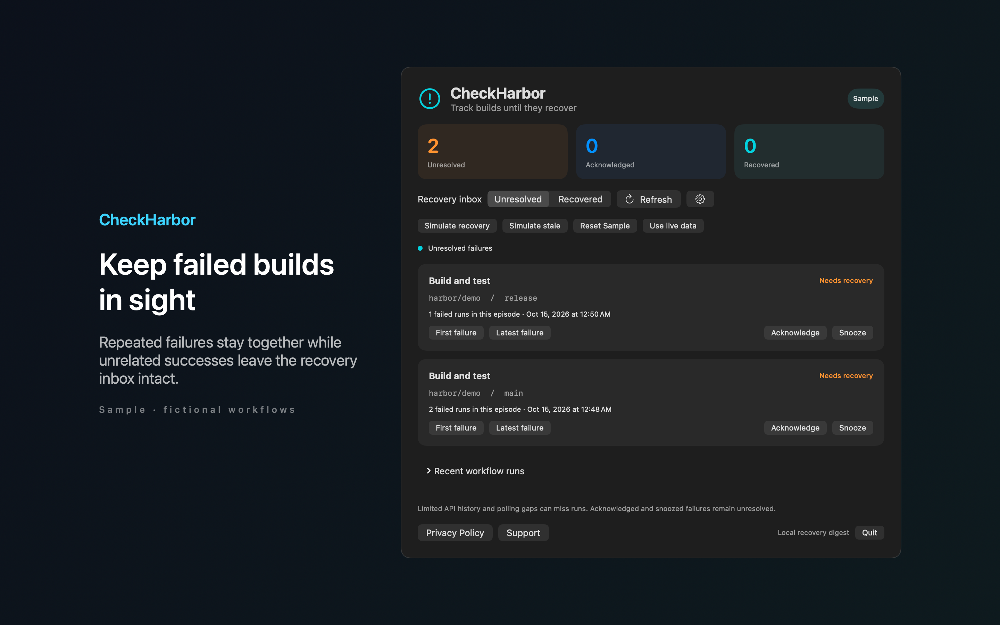
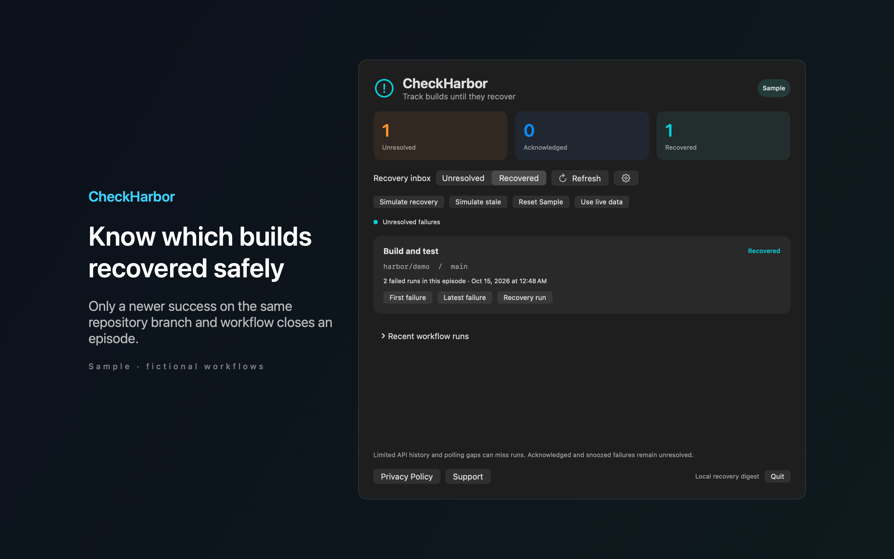

# CheckHarbor

CheckHarbor is a Mac menu bar app that keeps failed GitHub Actions runs visible until a matching run succeeds.





## Features

- Groups repeated failures into one episode for each repository, branch and workflow. An episode closes only when a newer run of the same workflow on the same branch succeeds.
- Acknowledge or snooze an episode. It stays unresolved until it recovers.
- Links to the first failure, the latest failure and the recovery run on github.com.
- Shows stale data, authentication errors and rate limit backoff. A global shortcut (Shift Command H by default) opens the unresolved list.
- Includes Sample mode with fictional workflows. Sample mode makes no network requests.

## Requirements

- macOS 14.0 or later.
- Sandboxed. Network access to api.github.com, to read the workflow runs of repositories you add.
- Public repositories need no token. Private repositories need a fine grained token with Actions read access. The token is stored in the Keychain.

## Build

You need Xcode 16 or later (Swift 5.9 or later).

```sh
cd apps/CheckHarbor
swift build -c release
```

The package depends on `../../kit/MASKit` by path. Clone the whole repository, so that the folder layout stays the same.

## Privacy

Repository names, run data and episodes stay on your Mac, and the optional token stays in the Keychain. Requests go only to api.github.com, and the app never fetches source code or workflow logs. Full policy: [store/privacy.md](store/privacy.md).

## License

MIT. See [LICENSE](../../LICENSE).
