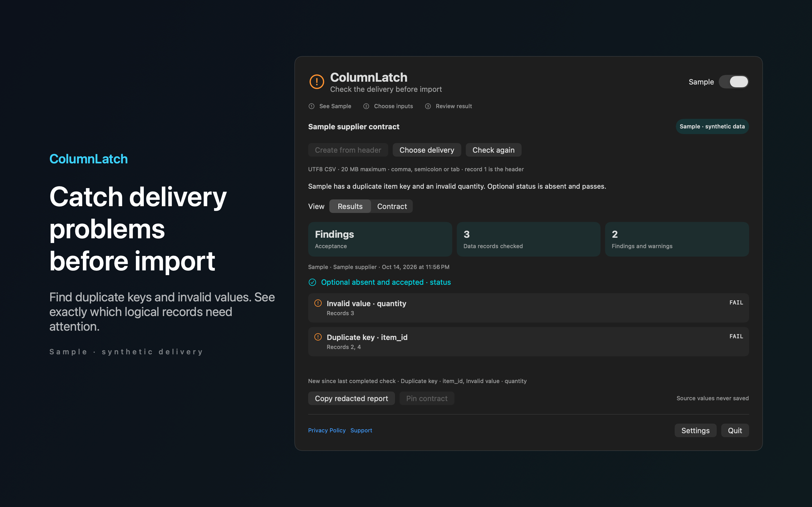

# ColumnLatch

Catch recurring CSV delivery problems before import. Save a supplier contract and check each delivery against the rules you chose.



## Features

- Make required and optional columns explicit. Choose text, integer, decimal or exact allowed values. Decide whether empty values are allowed and whether unexpected columns warn or fail. A unique key check identifies every repeated group without changing identifiers or losing leading zeros.
- Review missing fields, malformed records and invalid values by column and logical record number. Compare each completed check with the previous completed run for that contract. Incomplete checks never replace that baseline. Copy a value redacted acceptance report to share findings without source values.
- Choose comma, semicolon or tab for UTF8 CSV files up to 20 MB. Try the labeled Sample without selecting a file. Your source files are never modified. Rules, bookmarks and summaries stay on your Mac. No accounts, analytics or automatic network calls.

## Requirements

- macOS 14.0 or later.
- Sandboxed.
- Reads only the files and folders you choose. It never changes them.

## Build

You need Xcode 16 or later (Swift 5.9 or later).

```sh
cd apps/ColumnLatch
swift build -c release
```

The package depends on `../../kit/MASKit` by path. Clone the whole repository, so that the folder layout stays the same.

## Privacy

ColumnLatch has no account, analytics or developer data collection. Full policy: [store/privacy.md](store/privacy.md).

## Support this work

This app is free and open source. If it saves you time, you can support more apps like it through [GitHub Sponsors](https://github.com/sponsors/theluckystrike), [PayPal](https://paypal.me/najzzz) or [Buy Me a Coffee](https://buymeacoffee.com/michaellip).

## License

MIT. See [LICENSE](../../LICENSE).
