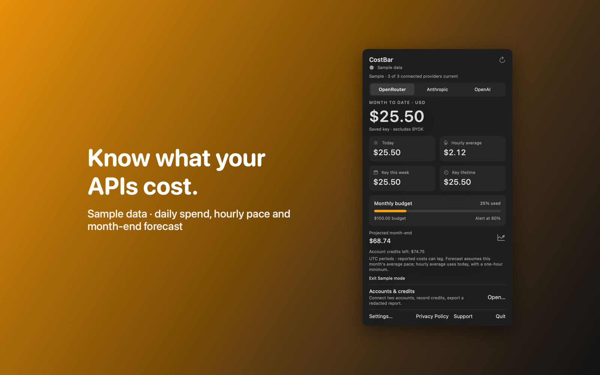

# CostBar

CostBar is a Mac menu bar app that shows the AI API costs that OpenRouter, Anthropic and OpenAI report for your accounts.



## Features

- Reads cost reports from OpenRouter, Anthropic and OpenAI with your own keys. It makes no inference requests. Each provider is shown separately, because their reports cover different things. Sample data lets you try the app without a key or a network request.
- Shows today's and this month's spend in USD, today's average spend per hour, and a month-end forecast. The forecast waits for at least three days and ten percent of the UTC month.
- Sets a monthly budget for each provider with an alert threshold. Alerts are local notifications. Budgets do not stop spending.
- Accounts and credits keeps several accounts apart. You can record dated credit grants with expiry and workload eligibility, and see the eligible total for one workload.
- Imports a JSON Lines log file you choose, up to 5 MB, for a token estimate. Exports a redacted JSON report with salted account pseudonyms.

## Download

Download [CostBar-1.0.0.dmg](https://github.com/theluckystrike/barframe-apps/releases/download/costbar-v1.0.0/CostBar-1.0.0.dmg) for macOS 14 or later. It is signed with Developer ID and notarized by Apple. The [release page](https://github.com/theluckystrike/barframe-apps/releases/tag/costbar-v1.0.0) lists its SHA-256.

## Install with Homebrew

```sh
brew install --cask theluckystrike/barframe/costbar
```

The cask comes from the [barframe tap](https://github.com/theluckystrike/homebrew-barframe). It installs the same signed and notarized disk image as the download link.

## Requirements

- macOS 14.0 or later.
- Sandboxed. Network access to request cost reports from OpenRouter, Anthropic and OpenAI over HTTPS.
- Read and write access to files that you choose, to import a log file and to save an exported report.
- Anthropic and OpenAI need an organization admin key to read costs. OpenRouter needs a management key to show account credits.

## Build

You need Xcode 16 or later (Swift 5.9 or later).

```sh
cd apps/CostBar
swift build -c release
```

The package depends on `../../kit/MASKit` by path. Clone the whole repository, so that the folder layout stays the same.

## Privacy

Keys stay in the macOS Keychain and go only to the provider you selected. Totals, settings and account records stay on your Mac, and CostBar sends nothing to the developer. Full policy: [store/privacy.md](store/privacy.md).

## Support this work

This app is free and open source. If it saves you time, you can support more apps like it through [GitHub Sponsors](https://github.com/sponsors/theluckystrike), [PayPal](https://paypal.me/najzzz) or [Buy Me a Coffee](https://buymeacoffee.com/michaellip).

More free apps and tools by the author are at https://barframe.com/projects/.

## License

MIT. See [LICENSE](../../LICENSE).
