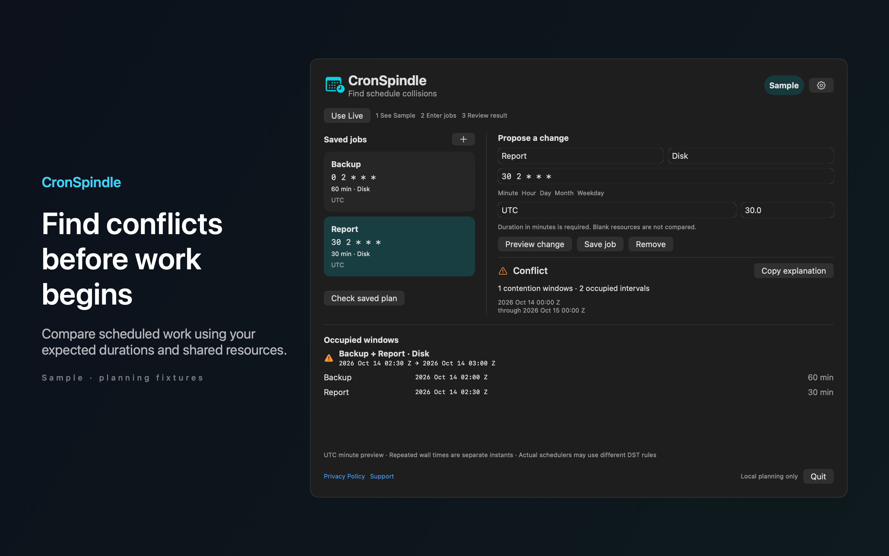

# CronSpindle

Find overlapping scheduled work before it competes for the same resource. Compare planned runtimes across time zones and preview how a schedule change affects contention.



## Features

- Create jobs with numeric five field cron expressions, expected durations and shared resource labels. Inspect exact collision windows and compare a proposed expression or duration with the saved original. Repeated local hours appear as separate instants with explicit UTC offsets.
- Choose a finite preview of up to thirty one days. Bounded analysis marks incomplete coverage clearly. This is a workload planner. Actual schedulers may apply different daylight saving rules.
- Explore labeled Sample fixtures without permissions or accounts. Save your plan locally and copy an explanation when you choose. No analytics, ads or automatic network calls.

## Requirements

- macOS 14.0 or later.
- Sandboxed.

## Build

You need Xcode 16 or later (Swift 5.9 or later).

```sh
cd apps/CronSpindle
swift build -c release
```

The package depends on `../../kit/MASKit` by path. Clone the whole repository, so that the folder layout stays the same.

## Privacy

CronSpindle has no account, analytics or developer data collection. Full policy: [store/privacy.md](store/privacy.md).

## Support this work

This app is free and open source. If it saves you time, you can support more apps like it through [GitHub Sponsors](https://github.com/sponsors/theluckystrike), [PayPal](https://paypal.me/najzzz) or [Buy Me a Coffee](https://buymeacoffee.com/michaellip).

## License

MIT. See [LICENSE](../../LICENSE).
