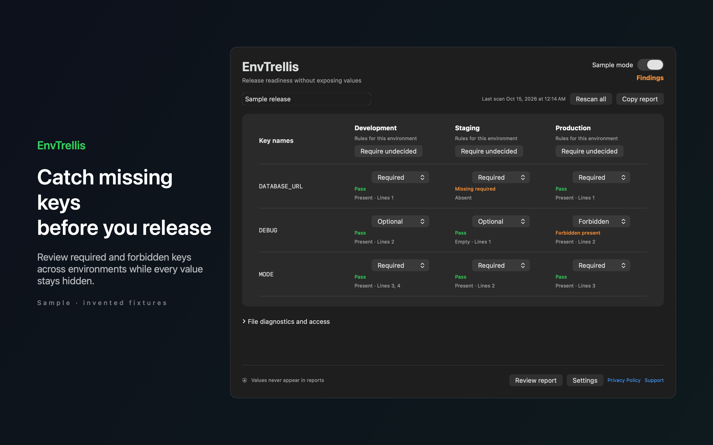

# EnvTrellis

Catch missing environment keys before a release. Save required, optional and forbidden key rules for each environment and review a report that never exposes values.



## Features

- Choose a template and several environment files. EnvTrellis reads only the files you select and stores read access bookmarks, key presence and your rule matrix locally. Required keys must be present and nonempty. Optional keys can be absent. Forbidden keys must be absent.
- A single rescan reviews every input. New template keys need a rule decision. Duplicate keys include line numbers, and unsupported multiline or expansion syntax blocks readiness. Missing files and expired access produce Unknown. Observable file changes mark the previous result Stale until you rescan.
- Pin a project in the menu bar, adjust rules in a native matrix and copy a release readiness report with key names, presence, outcomes and line numbers. Mask project and environment labels when sharing. Values are never displayed, saved or copied by the app.
- Try the clearly labeled Sample project immediately without granting file access. Settings include a remappable opening shortcut, appearance, English and Spanish interface text and optional launch at login, off by default.
- Your files and settings stay on your Mac. No accounts, analytics, cloud sync or automatic network calls. Inputs are never edited. Clearing local data removes saved projects, rules and access bookmarks while keeping your source files.

## Download

Download [EnvTrellis-1.0.0.dmg](https://github.com/theluckystrike/barframe-apps/releases/download/envtrellis-v1.0.0/EnvTrellis-1.0.0.dmg) for macOS 14 or later. It is signed with Developer ID and notarized by Apple. The [release page](https://github.com/theluckystrike/barframe-apps/releases/tag/envtrellis-v1.0.0) lists its SHA-256.

## Install with Homebrew

```sh
brew install --cask theluckystrike/barframe/envtrellis
```

The cask comes from the [barframe tap](https://github.com/theluckystrike/homebrew-barframe). It installs the same signed and notarized disk image as the download link.

## Requirements

- macOS 14.0 or later.
- Sandboxed.
- Reads only the files and folders you choose. It never changes them.

## Build

You need Xcode 16 or later (Swift 5.9 or later).

```sh
cd apps/EnvTrellis
swift build -c release
```

The package depends on `../../kit/MASKit` by path. Clone the whole repository, so that the folder layout stays the same.

## Privacy

EnvTrellis has no account, analytics or developer data collection. Full policy: [store/privacy.md](store/privacy.md).

## Support this work

This app is free and open source. If it saves you time, you can support more apps like it through [GitHub Sponsors](https://github.com/sponsors/theluckystrike), [PayPal](https://paypal.me/najzzz) or [Buy Me a Coffee](https://buymeacoffee.com/michaellip).

More free apps and tools by the author are at https://barframe.com/projects/.

## License

MIT. See [LICENSE](../../LICENSE).
