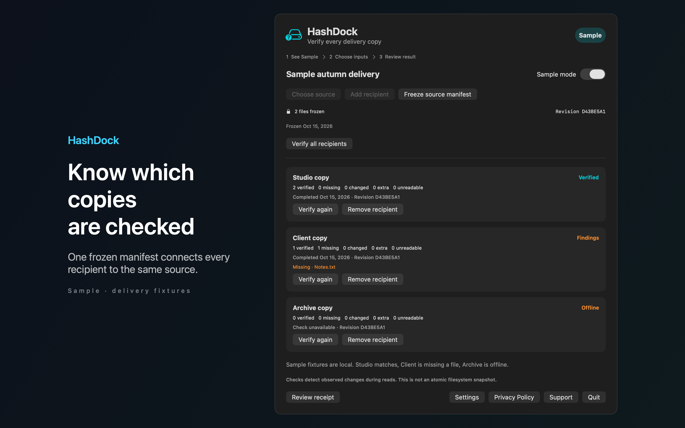

# HashDock

See which delivery copies have been checked against the same source. HashDock keeps named delivery jobs with a separate result for every recipient.



## Features

- Freeze a source manifest, then verify selected destination folders with streaming SHA256 checks. Review missing, changed, extra and unreadable files. Finder metadata is excluded with visible warnings. Empty sources cannot be frozen. Offline copies remain separate from verified copies. Refreshing the source resets every previous result.
- Copy a local delivery receipt with revision, coverage and verification times. Sample mode demonstrates a matching studio copy, a client copy with a missing file and an offline archive.
- Your files and settings stay on your Mac. No accounts, analytics or automatic network calls. File checks detect observed changes during reading and do not create an atomic filesystem snapshot.

## Download

Download [HashDock-1.0.0.dmg](https://github.com/theluckystrike/barframe-apps/releases/download/hashdock-v1.0.0/HashDock-1.0.0.dmg) for macOS 14 or later. It is signed with Developer ID and notarized by Apple. The [release page](https://github.com/theluckystrike/barframe-apps/releases/tag/hashdock-v1.0.0) lists its SHA-256.

## Requirements

- macOS 14.0 or later.
- Sandboxed.
- Reads only the files and folders you choose. It never changes them.

## Build

You need Xcode 16 or later (Swift 5.9 or later).

```sh
cd apps/HashDock
swift build -c release
```

The package depends on `../../kit/MASKit` by path. Clone the whole repository, so that the folder layout stays the same.

## Privacy

HashDock has no account, analytics or developer data collection. Full policy: [store/privacy.md](store/privacy.md).

## Support this work

This app is free and open source. If it saves you time, you can support more apps like it through [GitHub Sponsors](https://github.com/sponsors/theluckystrike), [PayPal](https://paypal.me/najzzz) or [Buy Me a Coffee](https://buymeacoffee.com/michaellip).

More free apps and tools by the author are at https://barframe.com/projects/.

## License

MIT. See [LICENSE](../../LICENSE).
