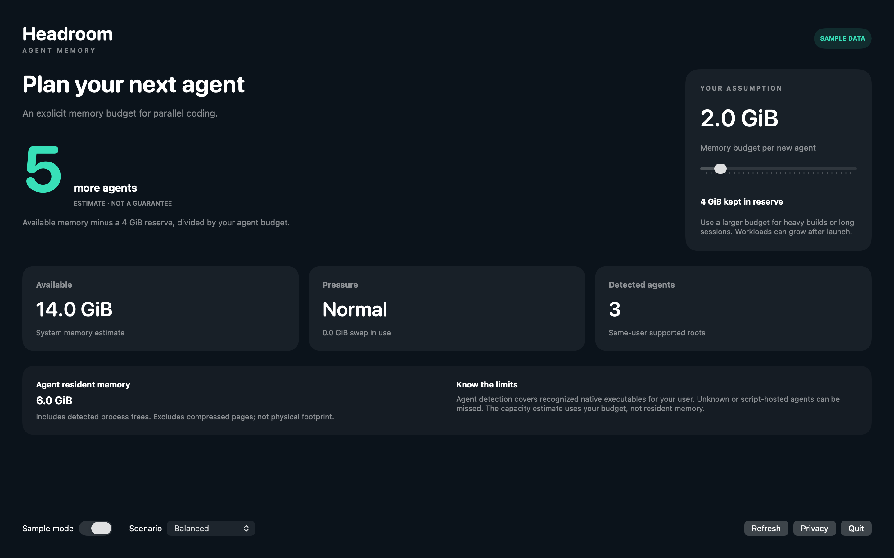
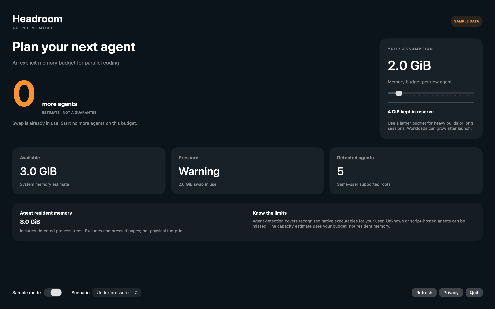

# Headroom Agent Memory

Headroom Agent Memory is a Mac menu bar app that estimates how many more coding agents fit in your Mac's memory.





## Features

- Estimates capacity as available memory minus a 4 GiB reserve, divided by the memory budget per agent that you set (0.5 to 16 GiB). Shows 0 when swap is in use or memory pressure is above normal. Shows no estimate when memory data is unavailable.
- Shows available memory, the memory pressure level and swap use. The reading refreshes every 5 seconds.
- Detects coding agents that run as your user by their executable name, such as claude, codex, gemini, aider and opencode. Script-hosted or unknown agents can be missed.
- Adds up the resident memory of the detected process trees. The value is marked partial when some processes cannot be read.
- Includes Sample mode with three scenarios: Balanced, Under pressure and Room to grow.

## Download

Download [Headroom-1.0.0.dmg](https://github.com/theluckystrike/barframe-apps/releases/download/headroom-v1.0.0/Headroom-1.0.0.dmg) for macOS 14 or later. It is signed with Developer ID and notarized by Apple. The [release page](https://github.com/theluckystrike/barframe-apps/releases/tag/headroom-v1.0.0) lists its SHA-256.

## Install with Homebrew

```sh
brew install --cask theluckystrike/barframe/headroom
```

The cask comes from the [barframe tap](https://github.com/theluckystrike/homebrew-barframe). It installs the same signed and notarized disk image as the download link.

## Requirements

- macOS 14.0 or later.
- Sandboxed, with no other entitlements. The app has no network access and no file access. It reads system memory statistics and the process list of your own user.

## Build

You need Xcode 16 or later (Swift 6.0 or later).

```sh
cd apps/Headroom
swift build -c release
```

## Privacy

Memory statistics and process details are read on your Mac. Process names, paths and arguments are not saved or sent, and the app has no network access. Full policy: [store/privacy.md](store/privacy.md).

## Support this work

This app is free and open source. If it saves you time, you can support more apps like it through [GitHub Sponsors](https://github.com/sponsors/theluckystrike), [PayPal](https://paypal.me/najzzz) or [Buy Me a Coffee](https://buymeacoffee.com/michaellip).

More free apps and tools by the author are at https://barframe.com/projects/.

## License

MIT. See [LICENSE](../../LICENSE).

The app is a port of upstream Headroom code by Michael Lip, which is also under the MIT License, as stated in [UPSTREAM-LICENSE.txt](UPSTREAM-LICENSE.txt).
