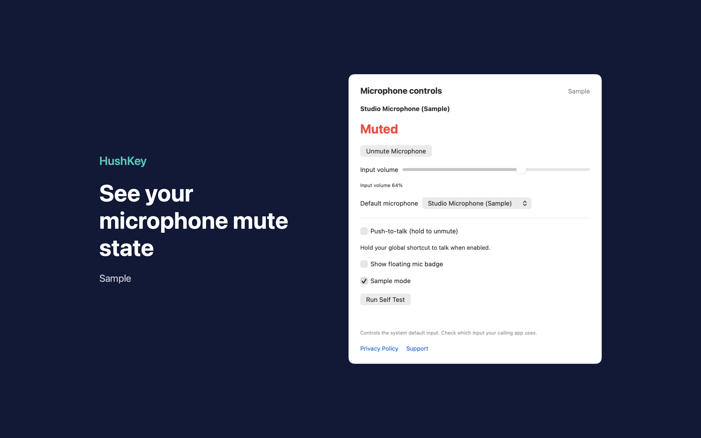
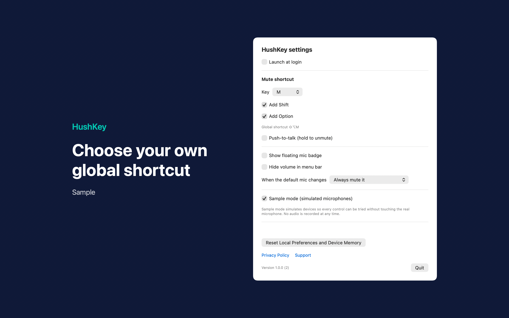

# HushKey Mic Mute Hotkey

HushKey Mic Mute Hotkey is a Mac menu bar app that mutes your default microphone with a global keyboard shortcut.





## Features

- Mutes and unmutes the system default input with Shift-Option-M. In Settings you can pick another key and turn Shift and Option on or off. With push-to-talk on, it unmutes while you hold the shortcut and mutes when you release it.
- Shows the mute state and input volume in the menu bar. An optional floating badge stays above other windows.
- Uses hardware mute when the device supports it. Otherwise it sets the input volume to zero and later restores the saved level, or half volume if no level was saved.
- When the default microphone changes, it can always mute the new device, keep it muted only if HushKey muted the previous one, or do nothing.
- Includes sample mode with simulated microphones, so you can try the controls without touching real hardware.

## Requirements

- macOS 14.0 or later.
- Sandboxed, with no other entitlements. It changes mute and volume through Core Audio device properties and does not ask for microphone access.

## Build

You need Xcode 16 or later (Swift 5.9 or later).

```sh
cd apps/HushKey
swift build -c release
```

The package depends on `../../kit/MASKit` by path. Clone the whole repository, so that the folder layout stays the same.

## Privacy

HushKey never opens an audio input stream or records audio. Preferences and per-device volume memory stay on your Mac, and the app makes no network connections. Full policy: [store/privacy.md](store/privacy.md).

## License

MIT. See [LICENSE](../../LICENSE).
