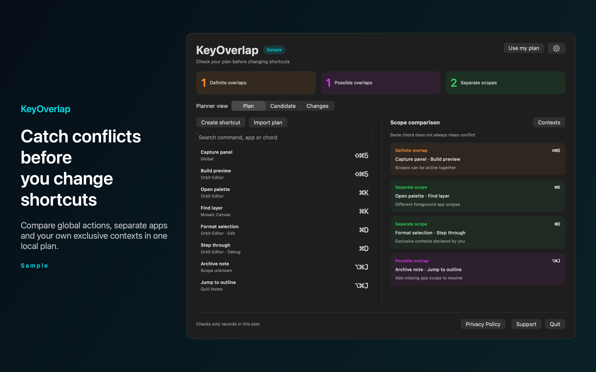
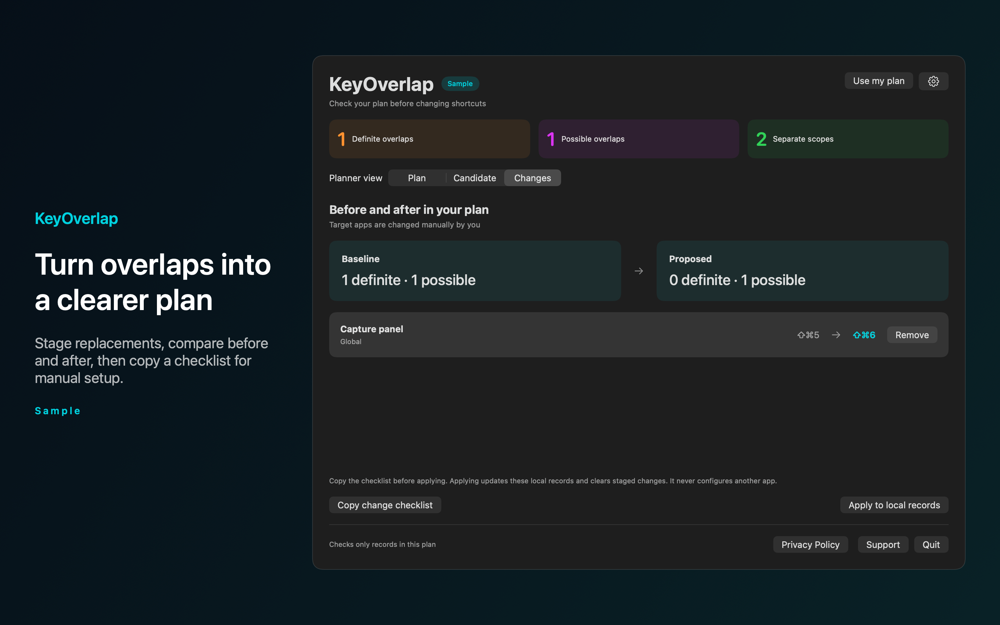

# KeyOverlap

KeyOverlap is a Mac menu bar app that checks a plan of keyboard shortcuts you enter and flags overlaps before you change your apps.




## Features

- Saves records with a command, a chord, an app scope (or `*` for global) and an optional context. Marks the same chord in overlapping scopes as a definite overlap, and a missing scope as a possible overlap. Contexts that you declare as mutually exclusive stay separate.
- Previews a candidate shortcut against your plan without changing saved records.
- Stages replacements, compares before and after, and copies a checklist so you can make the changes by hand in each app.
- Imports a JSON plan from a file you choose. The import replaces the records only if every row is valid. Search by command, app or chord.
- Opens the planner with Command Option K or another shortcut you register. Includes Sample mode and English and Spanish text.

KeyOverlap does not detect the shortcuts installed on your Mac. It checks only the records in your plan.

## Download

Download [KeyOverlap-1.0.0.dmg](https://github.com/theluckystrike/barframe-apps/releases/download/keyoverlap-v1.0.0/KeyOverlap-1.0.0.dmg) for macOS 14 or later. It is signed with Developer ID and notarized by Apple. The [release page](https://github.com/theluckystrike/barframe-apps/releases/tag/keyoverlap-v1.0.0) lists its SHA-256.

## Requirements

- macOS 14.0 or later.
- Sandboxed. Read-only access to a JSON file that you choose for import. No network access.

## Build

You need Xcode 16 or later (Swift 5.9 or later).

```sh
cd apps/KeyOverlap
swift build -c release
```

The package depends on `../../kit/MASKit` by path. Clone the whole repository, so that the folder layout stays the same.

## Privacy

Plans stay in the app sandbox on your Mac. The app does not monitor typing or read other apps, and makes no network requests. Full policy: [store/privacy.md](store/privacy.md).

## Support this work

This app is free and open source. If it saves you time, you can support more apps like it through [GitHub Sponsors](https://github.com/sponsors/theluckystrike), [PayPal](https://paypal.me/najzzz) or [Buy Me a Coffee](https://buymeacoffee.com/michaellip).

More free apps and tools by the author are at https://barframe.com/projects/.

## License

MIT. See [LICENSE](../../LICENSE).
