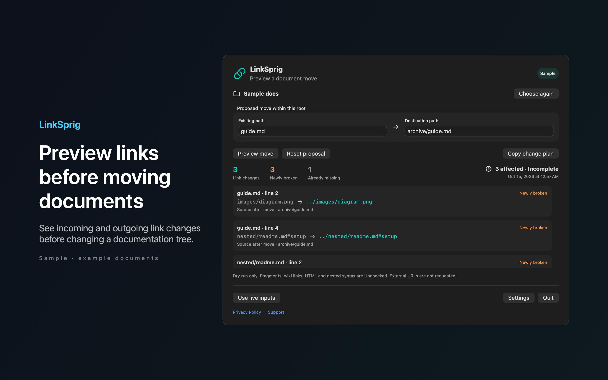

# LinkSprig

See which document links a proposed move would break before you change your files. Review incoming and outgoing links and copy a path change plan with original targets, replacements and line numbers.



## Features

- Choose a documentation folder and enter an existing file or folder path plus its proposed destination. LinkSprig simulates the move without writing to your documents. Newly broken links appear separately from targets that were already missing.
- Inline Markdown links, images and simple reference definitions are checked locally. Unsupported syntax, symbolic links, inaccessible files and fragment validity remain clearly marked for review. External URLs are never requested.
- Try Sample immediately to explore a document move without selecting files. Settings include image links, excluded folders, appearance, language and a disabled by default remappable panel shortcut.
- Your files, bookmarks and settings stay on your Mac. No accounts, analytics, ads, cloud sync or automatic network calls.

## Download

Download [LinkSprig-1.0.0.dmg](https://github.com/theluckystrike/barframe-apps/releases/download/linksprig-v1.0.0/LinkSprig-1.0.0.dmg) for macOS 14 or later. It is signed with Developer ID and notarized by Apple. The [release page](https://github.com/theluckystrike/barframe-apps/releases/tag/linksprig-v1.0.0) lists its SHA-256.

## Requirements

- macOS 14.0 or later.
- Sandboxed.
- Reads only the files and folders you choose. It never changes them.

## Build

You need Xcode 16 or later (Swift 5.9 or later).

```sh
cd apps/LinkSprig
swift build -c release
```

The package depends on `../../kit/MASKit` by path. Clone the whole repository, so that the folder layout stays the same.

## Privacy

LinkSprig has no account, analytics or developer data collection. Full policy: [store/privacy.md](store/privacy.md).

## Support this work

This app is free and open source. If it saves you time, you can support more apps like it through [GitHub Sponsors](https://github.com/sponsors/theluckystrike), [PayPal](https://paypal.me/najzzz) or [Buy Me a Coffee](https://buymeacoffee.com/michaellip).

More free apps and tools by the author are at https://barframe.com/projects/.

## License

MIT. See [LICENSE](../../LICENSE).
