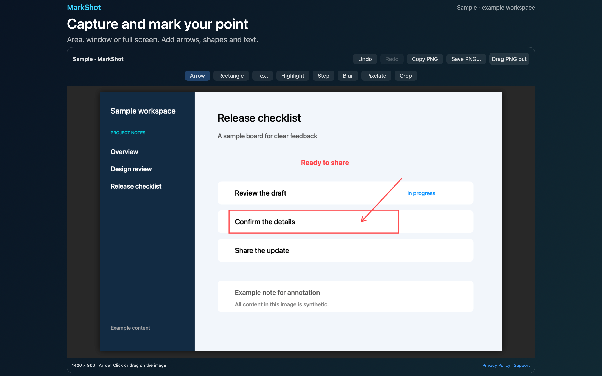
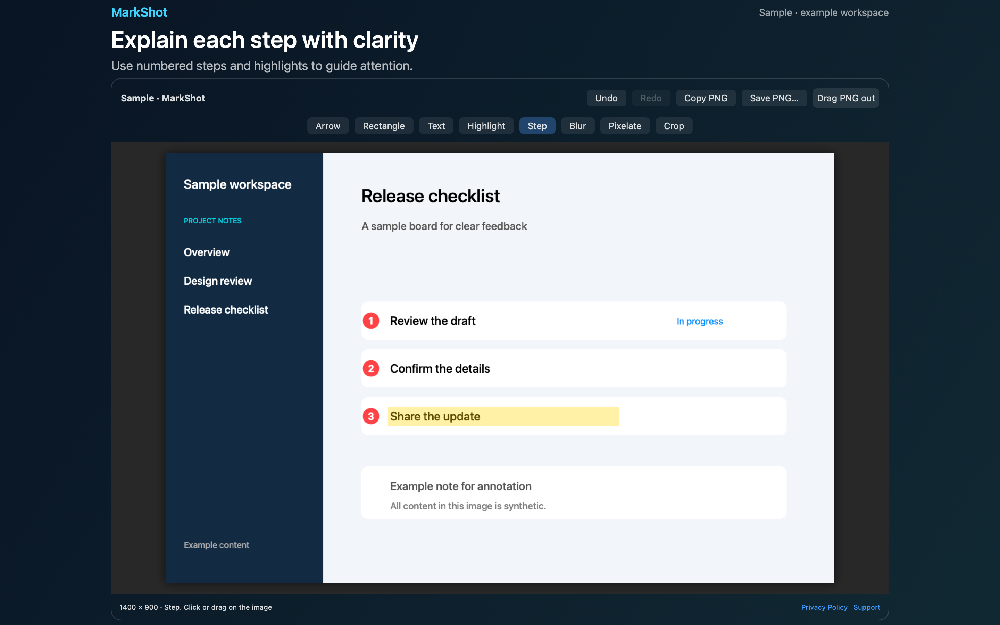

# MarkShot Screenshot Markup

MarkShot is a Mac menu bar app that captures a screenshot and lets you mark it up before you share it.





## Features

- Captures an area, a window or a full display. Press Escape to cancel an area selection. The Sample editor has a bundled image, so you can try the tools without Screen Recording permission.
- Adds arrows, rectangles, text, highlights and numbered steps. Blurs or pixelates a region, or crops the image. Undo and redo work for every edit.
- Copies the PNG to the clipboard, saves it to a folder you choose, or lets you drag it into another app.
- Keeps your last 10 captures as flattened PNGs. You can reopen one to add more marks, or clear the history from the menu.
- Sets a global shortcut for area capture. The default is Command-Shift-Option-S. You can pick 4, 5, 6 or S and turn Option on or off.

## Download

Download [MarkShot-1.0.0.dmg](https://github.com/theluckystrike/barframe-apps/releases/download/markshot-v1.0.0/MarkShot-1.0.0.dmg) for macOS 14 or later. It is signed with Developer ID and notarized by Apple. The [release page](https://github.com/theluckystrike/barframe-apps/releases/tag/markshot-v1.0.0) lists its SHA-256.

## Requirements

- macOS 14.0 or later.
- Screen Recording permission for live captures.
- Sandboxed. Read and write access to the save folder that you choose. MarkShot remembers that folder with a bookmark.

## Build

You need Xcode 16 or later (Swift 5.9 or later).

```sh
cd apps/MarkShot
swift build -c release
```

The package depends on `../../kit/MASKit` by path. Clone the whole repository, so that the folder layout stays the same.

## Privacy

MarkShot processes screenshots and annotations on your Mac. It does not collect data, use analytics or upload screenshots, and needs no account. Full policy: [store/privacy.md](store/privacy.md).

## Support this work

This app is free and open source. If it saves you time, you can support more apps like it through [GitHub Sponsors](https://github.com/sponsors/theluckystrike), [PayPal](https://paypal.me/najzzz) or [Buy Me a Coffee](https://buymeacoffee.com/michaellip).

## License

MIT. See [LICENSE](../../LICENSE).
