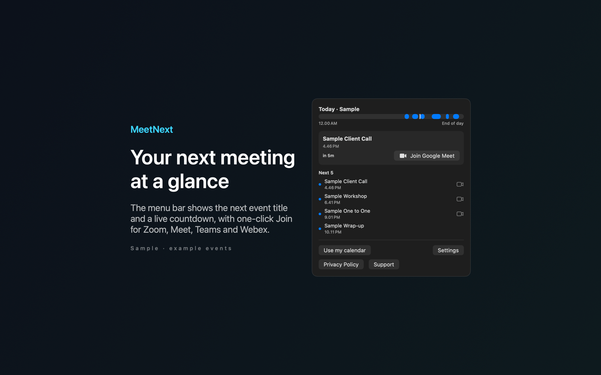

# MeetNext

MeetNext is a Mac menu bar app that shows your next meeting with a live countdown and a Join button.



## Features

- Shows the next meeting title and a countdown in the menu bar. Click it to see today's busy periods on a timeline with a marker for the current time, and the start times of your next five events.
- Finds Zoom, Google Meet, Microsoft Teams and Webex links in the event URL, location and notes. Join opens the next meeting's link in your browser or meeting app.
- Reads events for today and tomorrow from the calendars you choose in Settings. It leaves out all-day events and events with no duration.
- Sends optional local reminders 5, 10 or 15 minutes before a meeting.
- Includes sample mode with example events, so you can try the app without calendar access.

## Requirements

- macOS 14.0 or later.
- Sandboxed. Full access to your calendars, which macOS asks you to allow.
- Notification permission, only if you turn on reminders.

## Build

You need Xcode 16 or later (Swift 5.9 or later).

```sh
cd apps/MeetNext
swift build -c release
```

The package depends on `../../kit/MASKit` by path. Clone the whole repository, so that the folder layout stays the same.

## Privacy

MeetNext processes calendar events on your Mac and keeps their contents in memory. It has no account, analytics or developer data collection. Full policy: [store/privacy.md](store/privacy.md).

## License

MIT. See [LICENSE](../../LICENSE).
