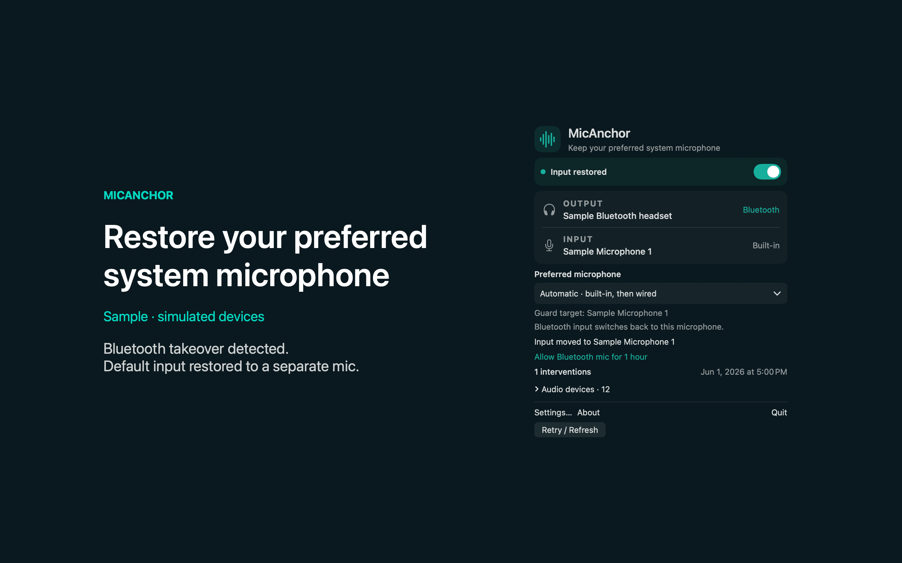

# MicAnchor

MicAnchor switches your system input back to a preferred microphone when a Bluetooth microphone takes over. It chooses the first available non-Bluetooth input in your saved priority order and leaves an available non-Bluetooth default input alone.



## Features

- Save your preferred microphones in Settings and put them in order. Preferences survive disconnects and restarts. If none is available, MicAnchor tries the built-in microphone before other wired inputs. When choosing an input automatically, MicAnchor skips recognized virtual and loopback devices, and it skips the built-in microphone when the lid is closed or the device reports that its input is unavailable to the system.
- You can pause the guard or allow a headset microphone for one hour. After three input-write attempts in 30 seconds, another required write pauses the guard for five minutes. Failed switches show a Retry option. Open the history to see recent switches and their reasons, or clear it.
- MicAnchor never records audio. It changes the system default input, which apps with their own microphone selection may ignore. You need a separate available microphone, and audio quality depends on your headphones and calling app.
- Preferences and a bounded switch history stay on your Mac. No account is needed. Sample mode lets you try switching and preferences without changing system audio, and Launch at Login stays off unless you enable it.

## Download

Download [MicAnchor-1.0.0.dmg](https://github.com/theluckystrike/barframe-apps/releases/download/micanchor-v1.0.0/MicAnchor-1.0.0.dmg) for macOS 14 or later. It is signed with Developer ID and notarized by Apple. The [release page](https://github.com/theluckystrike/barframe-apps/releases/tag/micanchor-v1.0.0) lists its SHA-256.

## Requirements

- macOS 14.0 or later.
- Sandboxed.

## Build

You need Xcode 16 or later (Swift 5.9 or later).

```sh
cd apps/MicAnchor
swift build -c release
```

The package depends on `../../kit/MASKit` by path. Clone the whole repository, so that the folder layout stays the same.

## Tests

Run `swift test` in `apps/MicAnchor`. With only the Command Line Tools installed, add the Testing framework path as shown below. All 63 tests pass (November 2026).

```sh
DEV=/Library/Developer/CommandLineTools/Library/Developer
swift test -Xswiftc -F"$DEV/Frameworks" -Xlinker -F"$DEV/Frameworks" \
  -Xlinker -rpath -Xlinker "$DEV/Frameworks" -Xlinker -rpath -Xlinker "$DEV/usr/lib"
```

## Privacy

MicAnchor has no account, analytics or developer data collection. Full policy: [store/privacy.md](store/privacy.md).

## Support this work

This app is free and open source. If it saves you time, you can support more apps like it through [GitHub Sponsors](https://github.com/sponsors/theluckystrike), [PayPal](https://paypal.me/najzzz) or [Buy Me a Coffee](https://buymeacoffee.com/michaellip).

More free apps and tools by the author are at https://barframe.com/projects/.

## License

MIT. See [LICENSE](../../LICENSE).
