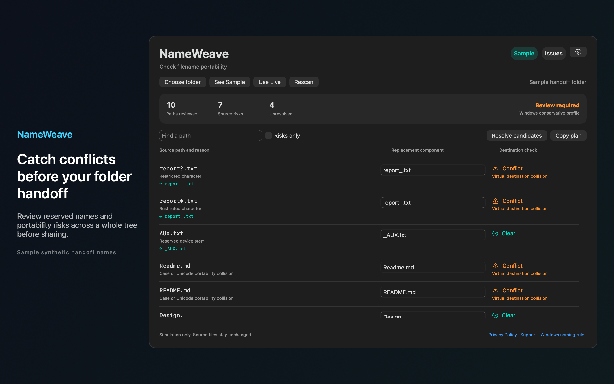

# NameWeave

Catch filename conflicts before handing a folder to another platform. NameWeave audits your selected folder and helps you build a replacement plan without changing source files.



## Features

- Review reserved device names, restricted characters and trailing dots or spaces under a labeled Windows compatibility profile. See case and Unicode normalization risks in the same folder. These conservative checks are compatibility targets rather than guarantees about every filesystem or application.
- Preview replacement names across the whole tree. Edit suggestions and see conflicts created by repairs themselves, including renamed parent folders. Resolve candidates and copy a before and after plan with reasons and remaining conflicts. A plan is Ready only after complete coverage and no unresolved destination issues.
- Set a destination prefix and an optional legacy path budget. Inaccessible folders, symbolic links, exclusions and scan limits remain visible as incomplete coverage. Hidden items are skipped and packages are reviewed as single items. Skipped dependency contents remain visible as incomplete coverage. Choose a folder with the standard file picker, save access locally and rescan when needed.
- Explore labeled Sample mode immediately. All processing stays on your Mac. There are no accounts, analytics, ads or automatic network calls.

## Requirements

- macOS 14.0 or later.
- Sandboxed.
- Reads only the files and folders you choose. It never changes them.

## Build

You need Xcode 16 or later (Swift 5.9 or later).

```sh
cd apps/NameWeave
swift build -c release
```

The package depends on `../../kit/MASKit` by path. Clone the whole repository, so that the folder layout stays the same.

## Privacy

NameWeave has no account, analytics or developer data collection. Full policy: [store/privacy.md](store/privacy.md).

## Support this work

This app is free and open source. If it saves you time, you can support more apps like it through [GitHub Sponsors](https://github.com/sponsors/theluckystrike), [PayPal](https://paypal.me/najzzz) or [Buy Me a Coffee](https://buymeacoffee.com/michaellip).

## License

MIT. See [LICENSE](../../LICENSE).
