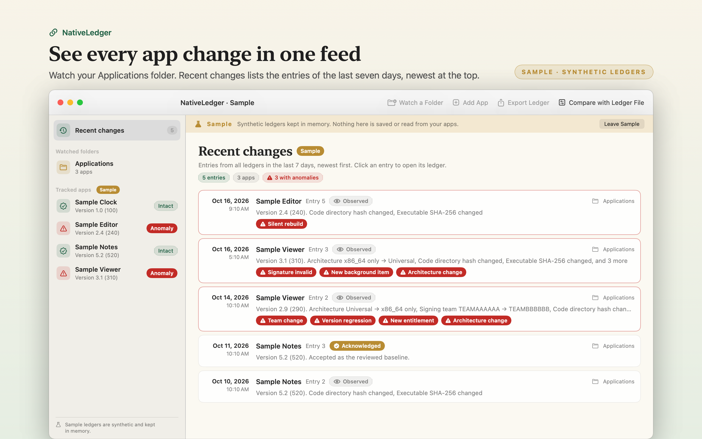
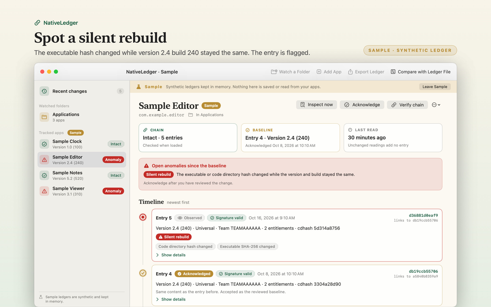

# NativeLedger

NativeLedger is a Mac app that keeps a hash chained ledger of app updates for the folders and apps you choose.





## Features

- Watches a folder, such as Applications, and adds a dated entry when an app in it changes. You can also add a single app. Recent changes lists the entries of the last 7 days.
- Each entry records the bundle identifier, version, build, architectures, signing team, entitlements, code directory hash, executable SHA-256, privacy usage descriptions, update feed address, background items and the result of the macOS code signature check.
- Flags silent rebuilds, version regressions, team changes, new background items, new usage descriptions, new entitlements, architecture changes, invalid signatures and changed update feeds. Optional local notifications cover an invalid signature, a team change or a new background item. Alerts are off by default.
- Each entry stores the SHA-256 of the entry before it. Verify chain names the first entry that does not match. Acknowledge records your reviewed baseline as a new entry.
- Exports a .nativeledger file without file paths. On another Mac, Compare with Ledger File shows which apps match, differ or exist on one Mac only.

## Download

Download [NativeLedger-1.0.0.dmg](https://github.com/theluckystrike/barframe-apps/releases/download/nativeledger-v1.0.0/NativeLedger-1.0.0.dmg) for macOS 14 or later. It is signed with Developer ID and notarized by Apple. The [release page](https://github.com/theluckystrike/barframe-apps/releases/tag/nativeledger-v1.0.0) lists its SHA-256.

## Requirements

- macOS 14.0 or later.
- Sandboxed. Read-only access to folders and apps that you choose in the system file picker, and write access to the place where you save an exported ledger.
- Notification permission, only if you turn on alerts.

## Build

You need Xcode 16 or later (Swift 5.9 or later).

```sh
cd apps/NativeLedger
swift build -c release
```

## Privacy

Ledgers stay in the app's sandbox container on your Mac. The app makes no network connections and has no account and no analytics. Full policy: [store/privacy.md](store/privacy.md).

## Support this work

This app is free and open source. If it saves you time, you can support more apps like it through [GitHub Sponsors](https://github.com/sponsors/theluckystrike), [PayPal](https://paypal.me/najzzz) or [Buy Me a Coffee](https://buymeacoffee.com/michaellip).

## License

MIT. See [LICENSE](../../LICENSE).
