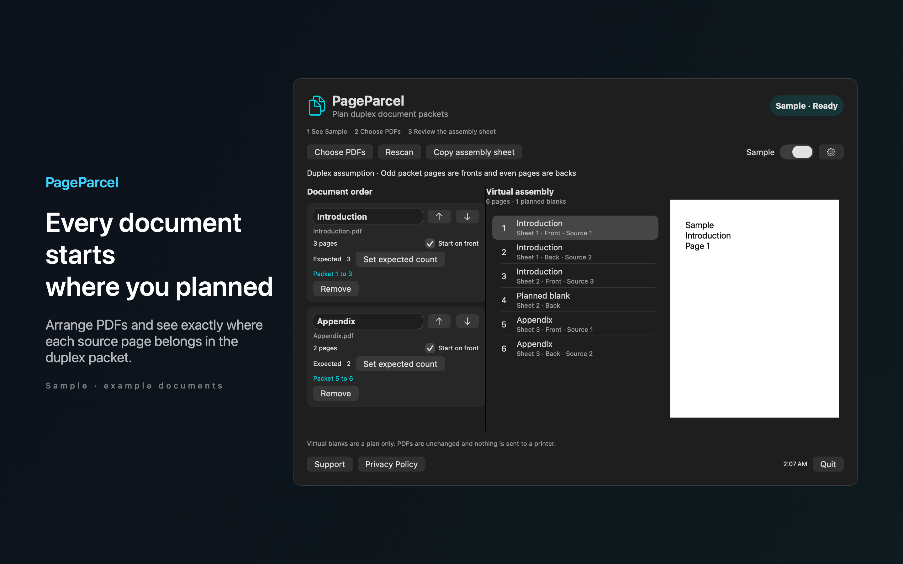

# PageParcel

Know where every document starts in a duplex packet. Arrange your PDFs, plan front side starts, and copy an assembly sheet with every planned blank page.



## Features

- See a virtual page map with source filenames, local page numbers and physical sheet sides. Preview the source pages while you check the packet. Reorder documents and change front side rules without modifying your PDFs or sending anything to a printer.
- Keep expected page counts and review mismatches after a rescan. Locked, empty and unavailable files stay unresolved so an incomplete packet never appears ready. Saved file access can be restored with Choose again.
- Try the labeled Sample packet before selecting files. Your files and packet state stay on your Mac. No accounts, analytics or automatic network calls.

## Requirements

- macOS 14.0 or later.
- Sandboxed.
- Reads only the files and folders you choose. It never changes them.

## Build

You need Xcode 16 or later (Swift 5.9 or later).

```sh
cd apps/PageParcel
swift build -c release
```

The package depends on `../../kit/MASKit` by path. Clone the whole repository, so that the folder layout stays the same.

## Privacy

PageParcel has no account, analytics or developer data collection. Full policy: [store/privacy.md](store/privacy.md).

## Support this work

This app is free and open source. If it saves you time, you can support more apps like it through [GitHub Sponsors](https://github.com/sponsors/theluckystrike), [PayPal](https://paypal.me/najzzz) or [Buy Me a Coffee](https://buymeacoffee.com/michaellip).

## License

MIT. See [LICENSE](../../LICENSE).
