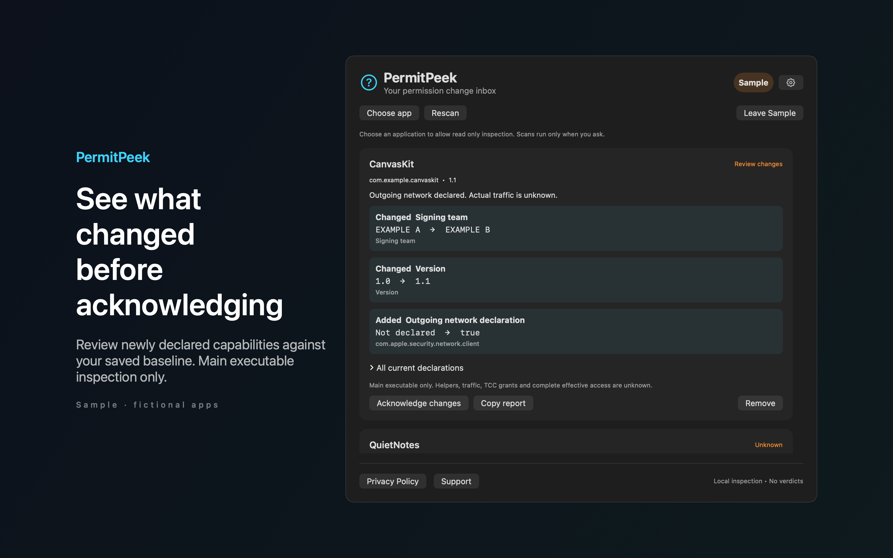

# PermitPeek

PermitPeek is a Mac menu bar app that shows how an app's code signing entitlements changed since the baseline you acknowledged.



## Features

- Reads the code signature of an app that you choose, without running it. Only the main executable is covered.
- Rescan compares entitlement keys and values, the app version and the signing team with your baseline. It lists added, removed and changed items.
- Acknowledge changes to make the current reading your new baseline. A failed read keeps the previous baseline. You can copy a text report, or remove a watched app without changing its bundle.
- Opens the inbox with a global shortcut, Shift Command P by default. You can choose another shortcut or turn it off in Settings.
- Includes Sample mode with two fictional apps, kept apart from your live watches.

## Download

Download [PermitPeek-1.0.0.dmg](https://github.com/theluckystrike/barframe-apps/releases/download/permitpeek-v1.0.0/PermitPeek-1.0.0.dmg) for macOS 14 or later. It is signed with Developer ID and notarized by Apple. The [release page](https://github.com/theluckystrike/barframe-apps/releases/tag/permitpeek-v1.0.0) lists its SHA-256.

## Requirements

- macOS 14.0 or later.
- Sandboxed. Read-only access to apps that you choose in the system file picker. No network access.

## Build

You need Xcode 16 or later (Swift 5.9 or later).

```sh
cd apps/PermitPeek
swift build -c release
```

The package depends on `../../kit/MASKit` by path. Clone the whole repository, so that the folder layout stays the same.

## Privacy

Signing details and baselines stay on your Mac. PermitPeek does not read documents, inspect traffic, collect analytics or contact a server. Full policy: [store/privacy.md](store/privacy.md).

## Support this work

This app is free and open source. If it saves you time, you can support more apps like it through [GitHub Sponsors](https://github.com/sponsors/theluckystrike), [PayPal](https://paypal.me/najzzz) or [Buy Me a Coffee](https://buymeacoffee.com/michaellip).

## License

MIT. See [LICENSE](../../LICENSE).
