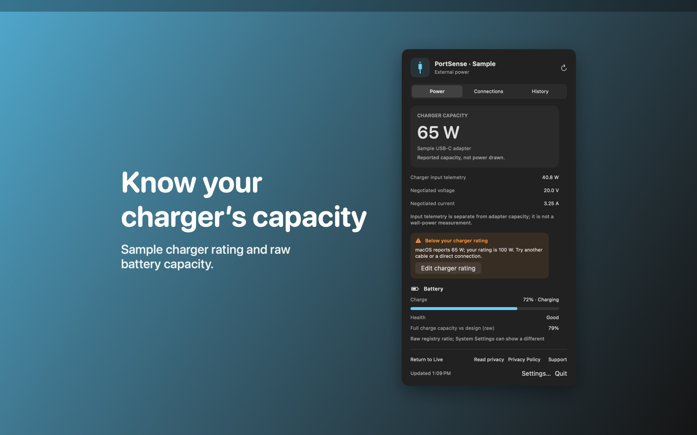

# PortSense

PortSense is a Mac menu bar app that shows the charger capacity, battery details and USB connections that macOS reports.



## Features

- Shows the charger capacity that macOS reports, with input telemetry, negotiated voltage and negotiated current. The menu bar shows the wattage, or the battery percentage when the Mac runs on battery.
- Warns when the reported capacity is lower than the rating printed on your charger. You enter the rating in Settings.
- Shows battery charge, health, cycle count, full charge capacity compared with design capacity, signed battery power, temperature and a time estimate.
- Lists USB devices with vendor, link speed ceiling, bus allocation and port current limit, and flags a USB 3 device at a USB 2 link ceiling. Also lists Thunderbolt devices. You can hide built-in devices.
- Keeps up to 60 recent charger readings in memory and charts them. It polls every 15 seconds and shows a failed read as a gap with a retry button. Sample mode lets you try all three tabs without attached hardware.

## Download

Download [PortSense-1.0.0.dmg](https://github.com/theluckystrike/barframe-apps/releases/download/portsense-v1.0.0/PortSense-1.0.0.dmg) for macOS 14 or later. It is signed with Developer ID and notarized by Apple. The [release page](https://github.com/theluckystrike/barframe-apps/releases/tag/portsense-v1.0.0) lists its SHA-256.

## Install with Homebrew

```sh
brew install --cask theluckystrike/barframe/portsense
```

The cask comes from the [barframe tap](https://github.com/theluckystrike/homebrew-barframe). It installs the same signed and notarized disk image as the download link.

## Requirements

- macOS 14.0 or later.
- Sandboxed, with no other entitlements. It reads power and USB details through public IOKit calls and asks for no permissions.

## Build

You need Xcode 16 or later (Swift 5.9 or later).

```sh
cd apps/PortSense
swift build -c release
```

The package depends on `../../kit/MASKit` by path. Clone the whole repository, so that the folder layout stays the same.

## Privacy

PortSense reads charger, battery and USB information locally. It has no account and no analytics, and charger history resets when you quit. Full policy: [store/privacy.md](store/privacy.md).

## Support this work

This app is free and open source. If it saves you time, you can support more apps like it through [GitHub Sponsors](https://github.com/sponsors/theluckystrike), [PayPal](https://paypal.me/najzzz) or [Buy Me a Coffee](https://buymeacoffee.com/michaellip).

More free apps and tools by the author are at https://barframe.com/projects/.

## License

MIT. See [LICENSE](../../LICENSE).
