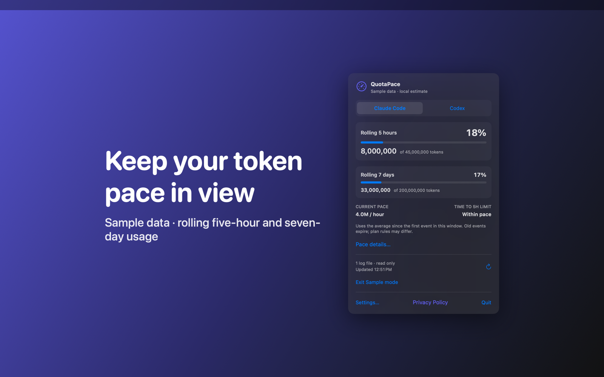

# QuotaPace

QuotaPace is a Mac menu bar app that counts tokens in your local Claude Code and Codex session logs and compares them with budgets you set.



## Features

- Reads JSONL session logs from a folder that you choose for Claude Code (`~/.claude/projects`) or Codex (`~/.codex/sessions`). It refreshes every 30 seconds.
- Shows rolling five-hour and seven-day token totals. The menu bar shows how much of your five-hour budget you have used. Repeated records are skipped, and Codex cumulative counters count as changes.
- Lets you set a five-hour and a seven-day token budget for each log format. These are your own numbers, not provider plan limits.
- Estimates your current pace and the time to your five-hour limit. The forecast accounts for old usage that leaves the rolling window. Pace details shows observed activity and projected usage.
- Includes sample mode with synthetic usage, so you can try every view without your logs.

## Requirements

- macOS 14.0 or later.
- Sandboxed. Read-only access to log folders that you choose in the system folder picker. An app-scoped bookmark keeps that access after a relaunch.
- No network access.

## Build

You need Xcode 16 or later (Swift 5.9 or later).

```sh
cd apps/QuotaPace
swift build -c release
```

The package depends on `../../kit/MASKit` by path. Clone the whole repository, so that the folder layout stays the same.

## Privacy

QuotaPace parses logs in memory and does not keep conversation text. Budgets, recent token counts and folder bookmarks stay in its sandbox container, and it sends nothing to the developer. Full policy: [store/privacy.md](store/privacy.md).

## License

MIT. See [LICENSE](../../LICENSE).
