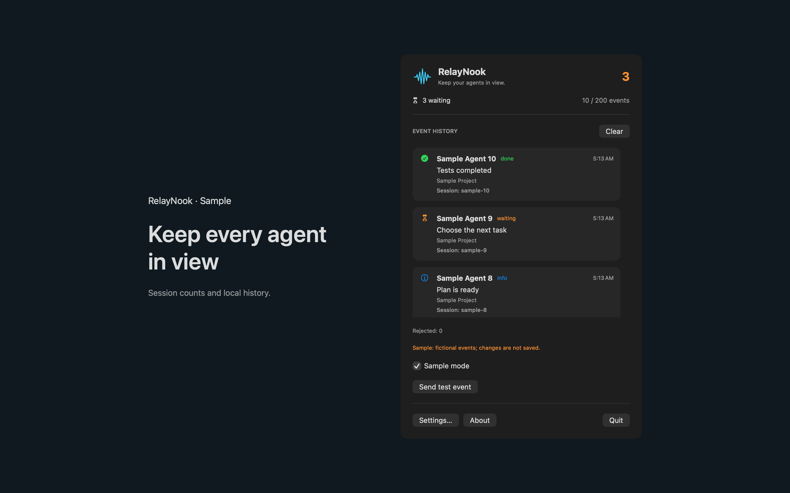
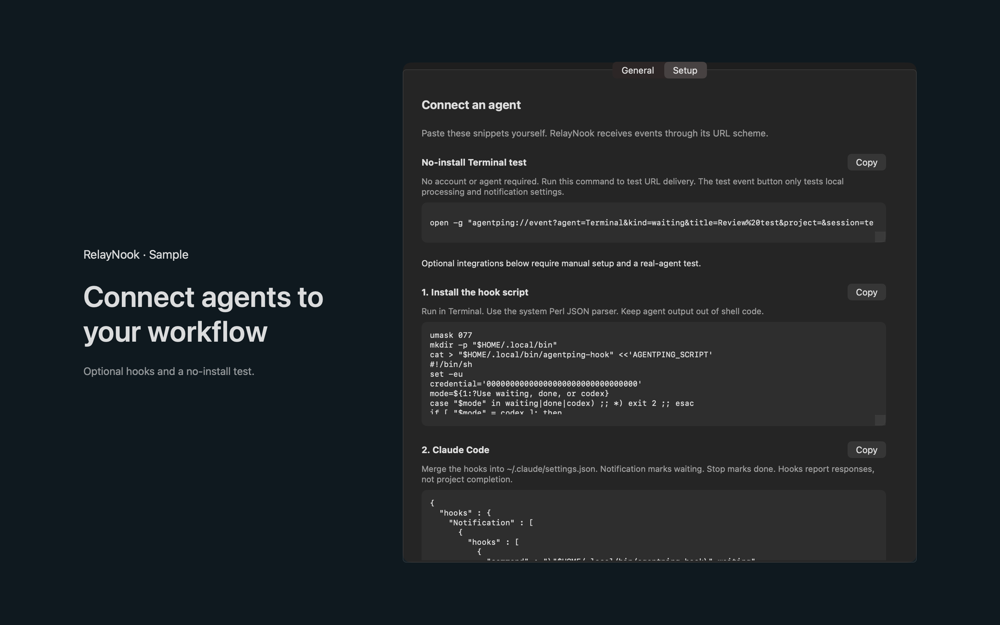

# RelayNook

RelayNook is a Mac menu bar app that receives events from coding agents and alerts you when a session needs input or finishes.




## Features

- Agents send events through the local `agentping://` URL scheme. Each event must carry the installation token. Kinds are waiting, done, error and info.
- Shows how many sessions are waiting for input, in the menu bar and in the panel. Keeps the last 200 events in local history. You choose which event kinds trigger notifications. Sound is optional.
- Copies setup snippets for Claude Code hooks, Codex CLI notifications and a generic shell function. You paste them into your own configuration. The app does not change it.
- Rejects events with a missing or wrong token, accepts at most 30 events per minute, and combines duplicate notifications for 10 seconds. You can regenerate the token.
- Includes Sample mode, a Send test event button and a Terminal test command that needs no install.

Codex CLI reports turn completion only. Waiting alerts depend on a hook that sends waiting events.

## Requirements

- macOS 14.0 or later.
- Sandboxed. No network access and no file access outside the app container. The app registers the `agentping` URL scheme and asks for notification permission when you enable notifications.

## Build

You need Xcode 16 or later (Swift 5.9 or later).

```sh
cd apps/RelayNook
swift build -c release
```

The Swift package and module are named AgentPing.

## Privacy

Event history, the installation token and preferences stay on your Mac. The app has no account, analytics or remote event service, and does not read agent configuration or transcript files. Full policy: [store/privacy.md](store/privacy.md).

## License

MIT. See [LICENSE](../../LICENSE).
