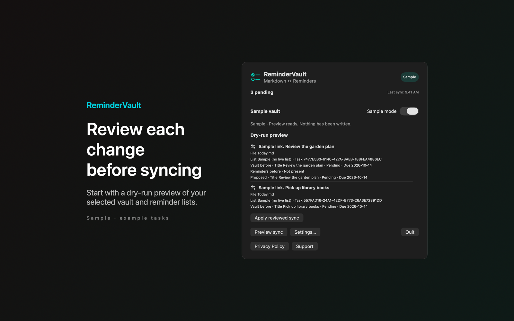

# ReminderVault

ReminderVault is a Mac menu bar app that syncs Markdown checkbox tasks in a folder with your selected Apple Reminders lists.



## Features

- Syncs `- [ ]` tasks in the Markdown files of a folder you choose with the writable Reminders lists you select. The mapping covers title, completion and due date (`📅 YYYY-MM-DD`). Other lines stay unchanged.
- Shows a dry-run preview of every change before anything is written. Nothing syncs until you apply it.
- New vault tasks go to the first selected list in alphabetical order. Imported reminders go into `ReminderVault Inbox.md`. A hidden `<!-- rv:... -->` comment links each task to its reminder.
- If both sides changed, the newest edit wins. Equal times favor the vault. A conflict log records each decision. Deletions are not carried across and are flagged for manual review.
- The menu lists pending tasks due today or earlier, and undated tasks. Check one off to write the completion back. After you apply a preview, it can sync every minute, every 5 or 15 minutes, or every hour. A failure pauses automatic sync.

A Sample vault lets you try the app. It never touches your reminders.

## Download

Download [ReminderVault-1.0.0.dmg](https://github.com/theluckystrike/barframe-apps/releases/download/remindervault-v1.0.0/ReminderVault-1.0.0.dmg) for macOS 14 or later. It is signed with Developer ID and notarized by Apple. The [release page](https://github.com/theluckystrike/barframe-apps/releases/tag/remindervault-v1.0.0) lists its SHA-256.

## Requirements

- macOS 14.0 or later.
- Sandboxed. Read and write access to the vault folder you choose. An app-scoped bookmark keeps that access after a restart.
- Full access to Reminders, which macOS asks for when you connect. The app does not request access to calendar events.

## Build

You need Xcode 16 or later (Swift 5.9 or later).

```sh
cd apps/ReminderVault
swift build -c release
```

The package depends on `../../kit/MASKit` by path. Clone the whole repository, so that the folder layout stays the same.

## Privacy

Task processing happens on your Mac. The app has no accounts, analytics or sync server. Your vault storage provider and your Reminders account may sync data on their own. Full policy: [store/privacy.md](store/privacy.md).

## Support this work

This app is free and open source. If it saves you time, you can support more apps like it through [GitHub Sponsors](https://github.com/sponsors/theluckystrike), [PayPal](https://paypal.me/najzzz) or [Buy Me a Coffee](https://buymeacoffee.com/michaellip).

## License

MIT. See [LICENSE](../../LICENSE).
