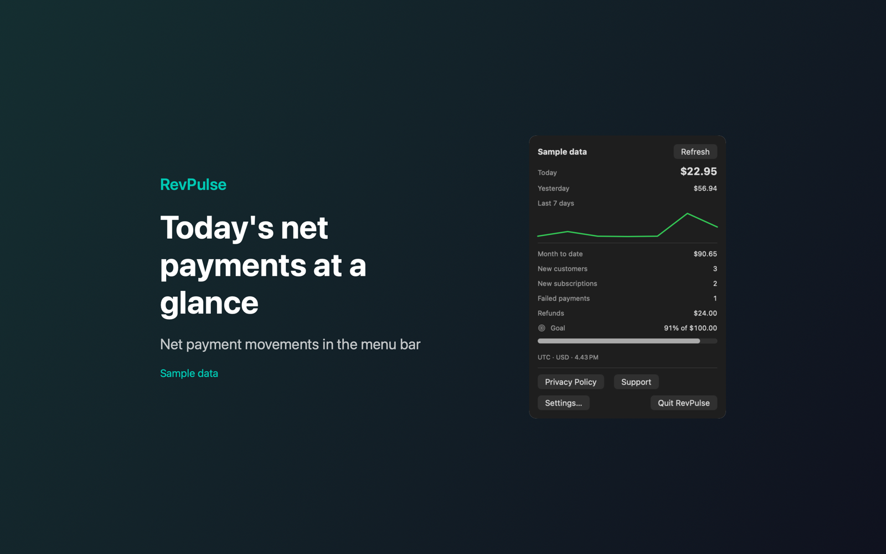

# RevPulse Revenue at a Glance

RevPulse is a Mac menu bar app that shows your Stripe net payments for the current UTC day.



## Features

- Shows today's net payments in the menu bar. The panel compares today with yesterday and draws a 7-day trend line.
- Lists month-to-date net payments, new customers, new subscriptions, failed payments and refunds, with progress toward a monthly goal that you set.
- Totals use payment and refund balance movements in your default settlement currency, with fees included. If it finds more than one settlement currency, it shows "Net unavailable" instead of adding them together.
- Refreshes every 1, 5, 15 or 30 minutes. Optional notifications for the first sale of the UTC day and for failed payments. Both start off.
- Includes Sample mode, so you can try the app without a Stripe key.

## Requirements

- macOS 14.0 or later.
- A Stripe restricted key (starts with `rk_`) with read access to charges, customers, subscriptions, refunds, balance transactions and account details.
- Sandboxed. Network access to api.stripe.com only. The key is stored in your macOS Keychain.

## Build

You need Xcode 16 or later (Swift 5.9 or later).

```sh
cd apps/RevPulse
swift build -c release
```

The package depends on `../../kit/MASKit` by path. Clone the whole repository, so that the folder layout stays the same.

## Privacy

The app sends read-only requests to api.stripe.com only. Revenue data stays in memory and is not written to disk. Settings stay in local preferences, and the key stays in your Keychain. Full policy: [store/privacy.md](store/privacy.md).

## License

MIT. See [LICENSE](../../LICENSE).
