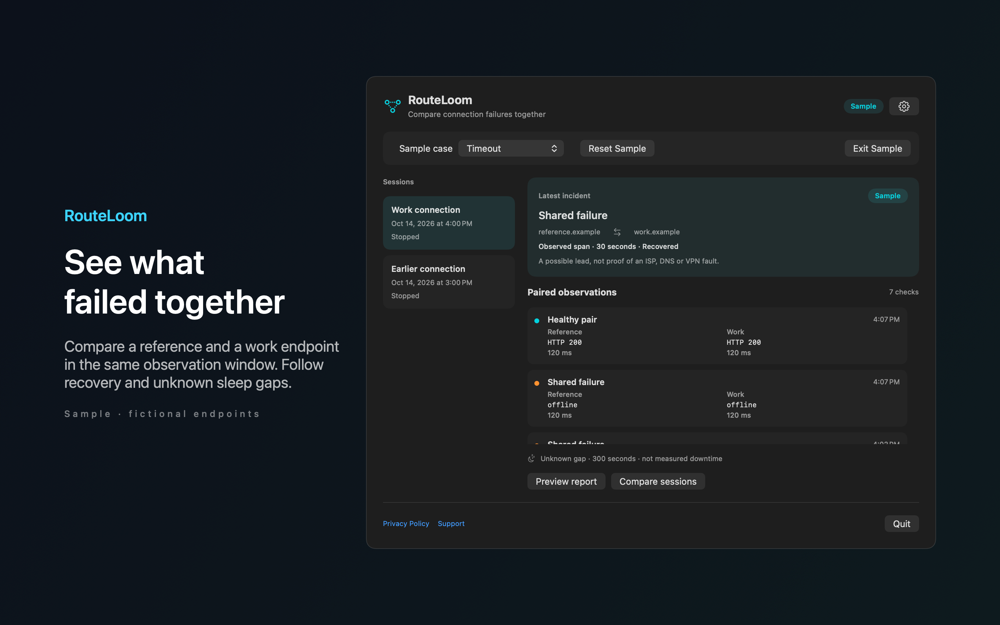
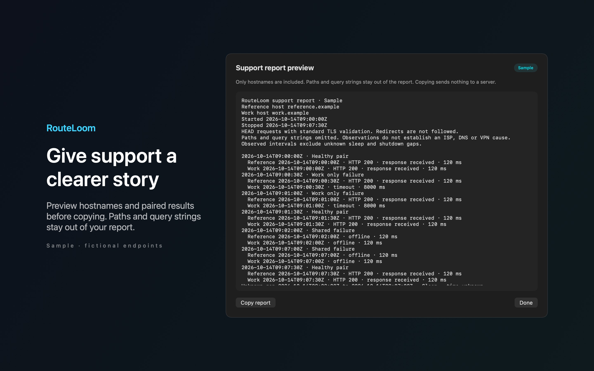

# RouteLoom Connection Report

RouteLoom is a Mac menu bar app that checks a reference endpoint and a work endpoint together, so you can see which side fails during a connection incident.




## Features

- Sends HTTPS HEAD requests to both endpoints at an interval you choose. Each pair is labeled as healthy, work only failure, reference only failure, shared failure or insufficient evidence. Each check records HTTP status codes, transport errors (timeout, offline, TLS, DNS, connection) and request durations with timestamps.
- Tracks each incident from failure to recovery. Sleep, shutdown and scheduling gaps are kept apart from observed failure time.
- Previews a support report before you copy it. The report includes hostnames but not URL paths or query strings.
- Compares a recent session with an earlier one saved on your Mac. Keeps 5, 20 or 50 recent sessions.
- Opens the current incident with Control Option R or Command Shift R, or you can turn the shortcut off. Includes Sample mode with timeout, TLS, offline and other cases, and English and Spanish text.

## Download

Download [RouteLoom-1.0.0.dmg](https://github.com/theluckystrike/barframe-apps/releases/download/routeloom-v1.0.0/RouteLoom-1.0.0.dmg) for macOS 14 or later. It is signed with Developer ID and notarized by Apple. The [release page](https://github.com/theluckystrike/barframe-apps/releases/tag/routeloom-v1.0.0) lists its SHA-256.

## Requirements

- macOS 14.0 or later.
- Sandboxed. Network access only to send HEAD requests to the two endpoints you configure. Redirects are not followed, and certificate validation stays on.

## Build

You need Xcode 16 or later (Swift 5.9 or later).

```sh
cd apps/RouteLoom
swift build -c release
```

The package depends on `../../kit/MASKit` by path. Clone the whole repository, so that the folder layout stays the same.

## Privacy

Endpoint settings and history stay in the app sandbox on your Mac. Requests go only to your two endpoints during a live session. The app has no telemetry, analytics or account. Full policy: [store/privacy.md](store/privacy.md).

## Support this work

This app is free and open source. If it saves you time, you can support more apps like it through [GitHub Sponsors](https://github.com/sponsors/theluckystrike), [PayPal](https://paypal.me/najzzz) or [Buy Me a Coffee](https://buymeacoffee.com/michaellip).

More free apps and tools by the author are at https://barframe.com/projects/.

## License

MIT. See [LICENSE](../../LICENSE).
