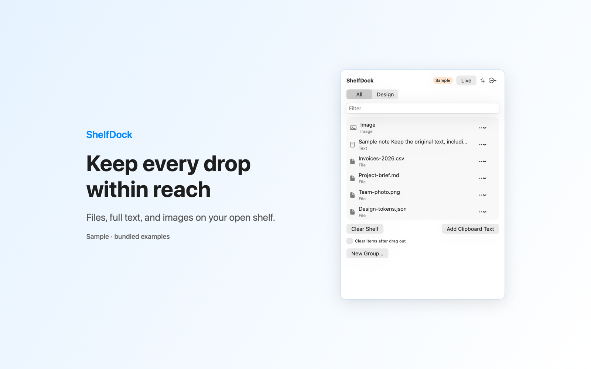

# ShelfDock

ShelfDock is a Mac menu bar app that holds files, folders, text and images on a shelf while you move between apps.



## Features

- Drop files, folders, plain text or images onto the shelf window. It holds up to 40 items. You can also add text from the clipboard.
- Sorts items into named groups and filters them by name.
- Drag a row into another app. The row menu can also copy, share or open the item in Quick Look. An option clears an item after another app accepts the drag, and Undo cleared drag brings it back.
- File entries point to your originals through saved bookmarks. A missing file shows a hint in its row.
- Includes a Sample shelf with bundled example files. Your real shelf stays saved while you try it.

## Requirements

- macOS 14.0 or later.
- Sandboxed. Read and write access only to files and folders that you drop on the shelf. App-scoped bookmarks keep that access after a restart.

## Build

You need Xcode 16 or later (Swift 5.9 or later).

```sh
cd apps/ShelfDrop
swift build -c release
```

The package depends on `../../kit/MASKit` by path. Clone the whole repository, so that the folder layout stays the same.

## Privacy

Shelf data stays in the app sandbox on your Mac. The app has no account, no analytics and no background uploads. Sharing an item through a system service can send it to that service. Full policy: [store/privacy.md](store/privacy.md).

## License

MIT. See [LICENSE](../../LICENSE).
