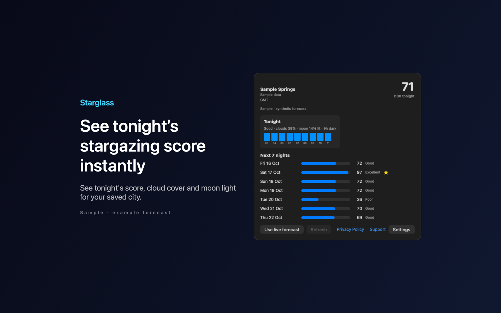

# Starglass Night Sky Planner

Starglass Night Sky Planner is a Mac menu bar app that scores stargazing conditions for tonight and the next seven nights in a city you choose.



## Features

- Scores each night from 0 to 100 from cloud cover, visibility, humidity and wind, plus local estimates of moonlight and darkness. The menu bar can show tonight's score.
- Shows hourly cloud cover through tonight's astronomical darkness, with the hours of darkness and how much of the moon is lit. Compares the next seven nights and marks the one with the highest score.
- Can notify you about two hours before a night that scores 70 or more. Notifications are off by default.
- Saves your city and the latest forecast, and marks a cached forecast when you are offline or the data is more than an hour old.
- Includes sample mode with a bundled synthetic forecast, so you can try it without a network connection or a saved city.

## Requirements

- macOS 14.0 or later.
- Sandboxed. Network access to Open-Meteo for city search and forecasts.
- No location permission. You search for a city by name.
- Notification permission, only if you turn on clear-night notifications.

## Build

You need Xcode 16 or later (Swift 5.9 or later).

```sh
cd apps/Starglass
swift build -c release
```

The package depends on `../../kit/MASKit` by path. Clone the whole repository, so that the folder layout stays the same.

## Privacy

City search text and the chosen city's coordinates go to Open-Meteo. Starglass has no account, analytics or tracking, and the developer runs no server that receives your data. Full policy: [store/privacy.md](store/privacy.md).

## License

MIT. See [LICENSE](../../LICENSE).
