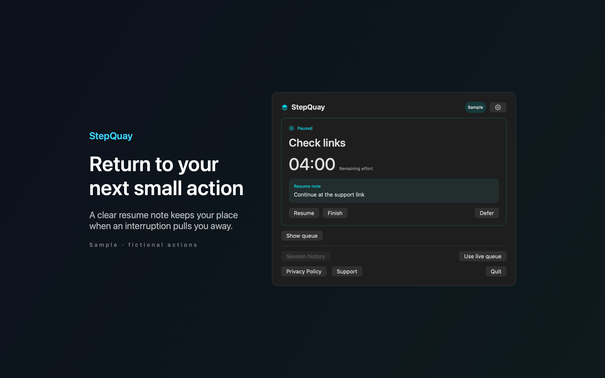
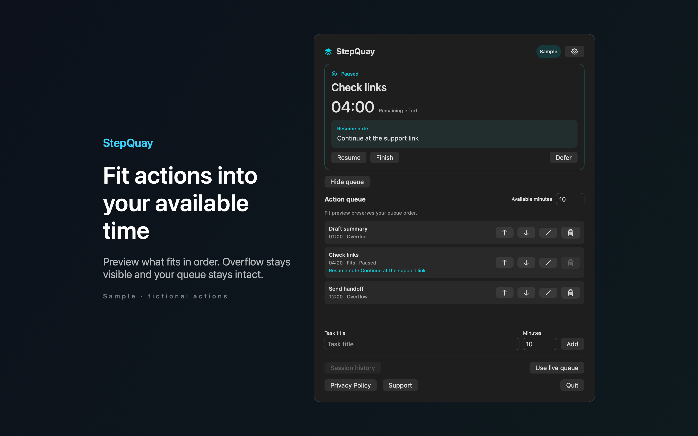

# StepQuay

StepQuay is a Mac menu bar app that keeps your next small action and a resume note in view, so you can return to it after an interruption.




## Features

- Builds an ordered queue of actions, each with an effort estimate in minutes.
- Enter your available minutes to see which actions fit, in queue order. The rest are marked as overflow.
- Interrupting an action asks for a short resume note. The note is shown when you come back. Sleep pauses timing until you resume.
- When the estimate runs out, the action stays open. You can continue, revise the remaining time or defer it. Finish when you are done, and undo a completion if needed. Local history keeps estimated time, active time and notes for 7, 30 or 90 days, or forever.
- Opens the panel with Command Option K by default, or another combination in Settings. In the panel, Command Return starts, Command I interrupts, Command R resumes and Command F finishes. Includes Sample mode and English and Spanish text.

## Download

Download [StepQuay-1.0.0.dmg](https://github.com/theluckystrike/barframe-apps/releases/download/stepquay-v1.0.0/StepQuay-1.0.0.dmg) for macOS 14 or later. It is signed with Developer ID and notarized by Apple. The [release page](https://github.com/theluckystrike/barframe-apps/releases/tag/stepquay-v1.0.0) lists its SHA-256.

## Install with Homebrew

```sh
brew install --cask theluckystrike/barframe/stepquay
```

The cask comes from the [barframe tap](https://github.com/theluckystrike/homebrew-barframe). It installs the same signed and notarized disk image as the download link.

## Requirements

- macOS 14.0 or later.
- Sandboxed. No network access and no special permissions.

## Build

You need Xcode 16 or later (Swift 5.9 or later).

```sh
cd apps/StepQuay
swift build -c release
```

The package depends on `../../kit/MASKit` by path. Clone the whole repository, so that the folder layout stays the same.

## Privacy

Actions, notes and history stay in the app sandbox on your Mac. The app makes no network requests and has no accounts or analytics. Full policy: [store/privacy.md](store/privacy.md).

## Support this work

This app is free and open source. If it saves you time, you can support more apps like it through [GitHub Sponsors](https://github.com/sponsors/theluckystrike), [PayPal](https://paypal.me/najzzz) or [Buy Me a Coffee](https://buymeacoffee.com/michaellip).

More free apps and tools by the author are at https://barframe.com/projects/.

## License

MIT. See [LICENSE](../../LICENSE).
